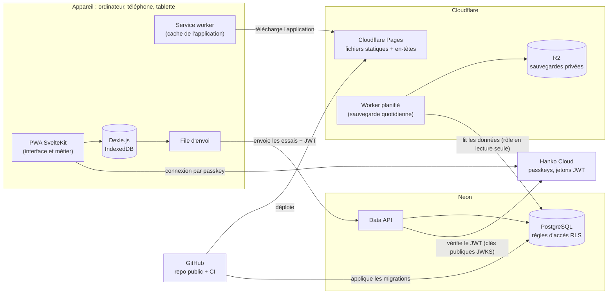
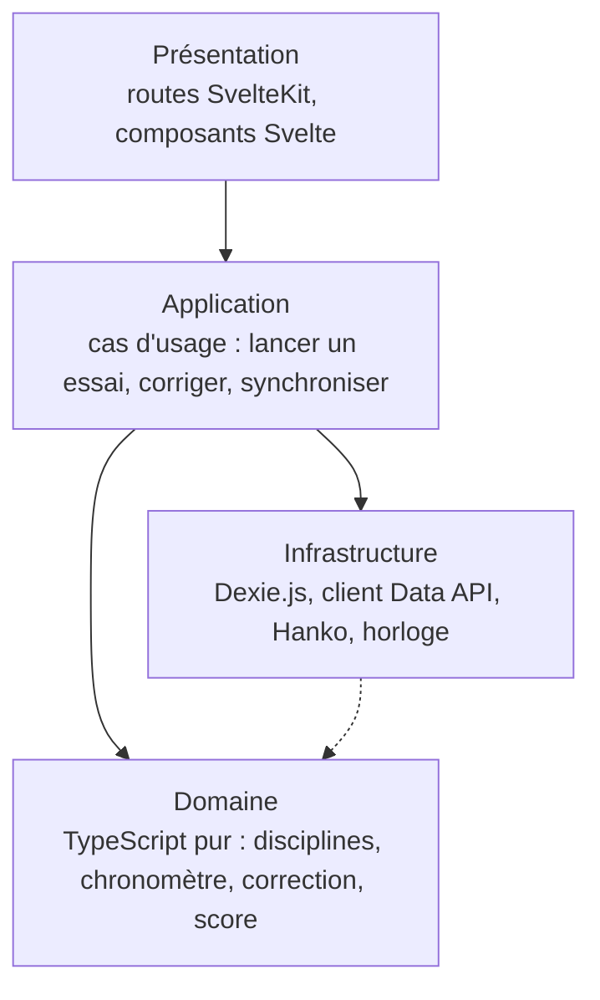

# S2 — Architecture

Amont : [benchmark](benchmark.md), [ADR](adr/), [exigences](../01-besoin/exigences.md), [exigences de sécurité](../03-analyse-securite/exigences-securite.md), [stratégie de sécurisation](../03-analyse-securite/menaces.md#4-stratégie-de-sécurisation).

## En bref

- **Tout le métier tourne sur l'appareil** : l'application est une PWA SvelteKit qui fonctionne entièrement hors ligne, avec ses données dans le navigateur (Dexie.js).
- **Le serveur ne fait que stocker et protéger** : Neon garde la copie de référence, et ses règles d'accès décident de tout (STRAT01). Il n'y a **aucun serveur applicatif à écrire**.
- **Trois services externes** : Hanko pour la connexion, Neon pour les données, Cloudflare pour l'hébergement (Pages) et la sauvegarde. La sauvegarde est faite par un **Worker**, une petite fonction exécutée à heure fixe, qui dépose les fichiers dans **R2**, le stockage de fichiers de Cloudflare (équivalent d'Amazon S3).
- **La synchronisation ne fait qu'ajouter** des essais, avec un identifiant créé sur l'appareil : pas de doublon (RG22).

## 1. Vue d'ensemble

## 2. Composants

| Composant | Rôle | Technologie | Exigences |
|---|---|---|---|
| **Application** | Interface, déroulé des essais, correction, statistiques | SvelteKit en mode SPA, TypeScript ([ADR 0007](adr/0007-sveltekit-mode-spa.md)) | EF01 à EF23, ENF08 |
| **Service worker** | Met l'application en cache pour qu'elle démarre sans réseau | vite-plugin-pwa et Workbox ([ADR 0008](adr/0008-service-worker-vite-plugin-pwa.md)) | ENF02 |
| **Base locale** | Toutes les données de l'utilisateur, consultables hors ligne | Dexie.js sur IndexedDB ([ADR 0004](adr/0004-hors-ligne-sur-mesure-dexie.md)) | ENF02, ENF07 |
| **File d'envoi** | Garde les essais à envoyer et les transmet au retour du réseau | Code maison, sur Dexie.js | RG22, ES06 |
| **Connexion** | Passkeys, émission des jetons JWT | Hanko Cloud ([ADR 0003](adr/0003-connexion-hanko.md)) | ES01 à ES03 |
| **Données de référence** | Copie de référence, synchronisée entre les appareils | Neon : PostgreSQL et Data API ([ADR 0002](adr/0002-backend-neon.md)) | EF21, ES04 à ES07 |
| **Hébergement** | Sert les fichiers de l'application et les en-têtes de sécurité | Cloudflare Pages ([ADR 0005](adr/0005-hebergement-cloudflare-pages.md)) | ES13 |
| **Sauvegarde** | Exporte les données chaque jour, en JSON | Worker Cloudflare planifié et R2 ([ADR 0009](adr/0009-sauvegarde-cloudflare-worker-r2.md)) | ES17, ES18 |
| **Repo et CI** | Code source, tests, déploiement, migrations | GitHub ; pipeline détaillé en Q3 | ES09, ES11, ES19 |

## 3. Couches de l'application

L'application suit une architecture en couches. La règle : **une couche ne dépend que des couches situées en dessous d'elle**, et le **domaine ne dépend de rien**.

| Couche | Contenu | Dépend de | Tests |
|---|---|---|---|
| **Présentation** | Écrans, saisie au clavier et au toucher, affichage du chronomètre | Application | Bout en bout |
| **Application** | Enchaînement d'un essai, abandon, file d'envoi, synchronisation | Domaine, Infrastructure | Intégration |
| **Domaine** | Règles de gestion RG01 à RG25 : formats, pauses de préparation, tirage, correction, score, points IAM | Rien | **Unitaires**, en priorité (O3) |
| **Infrastructure** | Accès à Dexie.js, à la Data API et à Hanko ; horloge monotone | Domaine (types seulement) | Intégration |

Deux conséquences :
- Les règles de gestion sont testables **sans navigateur ni base** : c'est le terrain du TDD (choix justifié en Q1).
- Le chronomètre lit une **horloge monotone** (`performance.now()`), indépendante de l'affichage (ENF01, ENF08, R6). Elle est injectée dans le domaine, ce qui permet de la simuler dans les tests.

## 4. Flux principaux

Le détail de chaque flux est dans les diagrammes de séquence (S5).

| Flux | Déroulé | Exigences |
|---|---|---|
| **Essai** | Le domaine tire les éléments, chronomètre, corrige et calcule le score **sur l'appareil**. L'essai terminé est écrit dans Dexie.js et ajouté à la file d'envoi. | EF08 à EF10, ENF01, ENF02 |
| **Synchronisation** | À l'ouverture et au retour du réseau, la file envoie chaque essai à la Data API, avec son identifiant créé sur l'appareil. Un essai déjà reçu est ignoré. Les essais faits sur les autres appareils sont ensuite téléchargés. | RG22, ES06, EF21 |
| **Connexion** | Passkey auprès de Hanko, qui renvoie un JWT. Chaque requête à la Data API porte ce JWT. Neon le vérifie avec les clés publiques de Hanko, puis les règles RLS filtrent les données du propriétaire. | ES02, ES04 |
| **Sauvegarde** | Chaque jour, le Worker lit les données avec un rôle en lecture seule et les écrit en JSON dans R2. Les essais étant immuables, seuls les **nouveaux essais** sont exportés, plus un instantané des systèmes. | ES17, ES18 |
| **Déploiement** | Une pull request vers `main` lance les tests. Une fois fusionnée, la CI applique les migrations sur Neon, après une sauvegarde, puis publie sur Cloudflare Pages. | ES19, Q3 |

## 5. Où sont appliquées les règles

| Règle | Sur l'appareil | Dans la base (Neon) |
|---|---|---|
| Score, correction, formats (RG01 à RG17) | **Calcul** (domaine) | Contrôle des bornes : par exemple, le score ne dépasse pas le nombre d'éléments (ES07) |
| Essai terminé immuable (RG18) | Aucune action de modification proposée | **Refus** de toute modification ou suppression (ES05) |
| Pas de doublon (RG22) | Identifiant unique créé sur l'appareil | **Clé unique** : un deuxième envoi est ignoré (ES06) |
| Accès aux données | — | **RLS** : propriétaire uniquement, tout le reste refusé (ES04) |

Le score est calculé sur l'appareil, car l'essai doit fonctionner hors ligne. La base n'a pas besoin de le recalculer : il n'y a qu'un seul utilisateur, et elle vérifie que les valeurs restent cohérentes.

## 6. Secrets et clés

| Où | Ce qui s'y trouve | Secret ? |
|---|---|---|
| **Front** (public) | Adresse de la Data API, adresse et identifiant publics de Hanko | **Non** : aucune clé secrète (ES08) |
| **Secrets du Worker** | Accès à la base avec un rôle **en lecture seule**, accès en écriture à R2 | Oui |
| **Secrets de la CI** | Jeton de déploiement Cloudflare, accès à la base pour les migrations | Oui (ES09, ES11) |
| **Poste du développeur** | Fichier `.env` local, ignoré par git | Oui |

## 7. Environnements

| Environnement | Front | Base | Données |
|---|---|---|---|
| **Dev local** | Serveur de développement Vite | Branche `dev` de Neon | Données de test fictives (ES10) |
| **Prod** | Cloudflare Pages | Branche principale de Neon | Données réelles |

> Hypothèse à valider : la base de dev est une **branche Neon** (gratuite, copie isolée de la structure). L'autre option est un PostgreSQL local. Choix au sprint 0.

## 8. Ce qui est décidé plus tard

| Sujet | Quand |
|---|---|
| Stockage et mise en cache des contenus (images, visages, listes de mots et de prénoms) | Avant le lot 2 (spécification progressive) |
| Téléversement d'images dans les systèmes | Avant le lot 5 ([A1](../03-analyse-securite/rgpd.md)) |
| Outils de test, de lint et de formatage | Q1 et Q3 |
