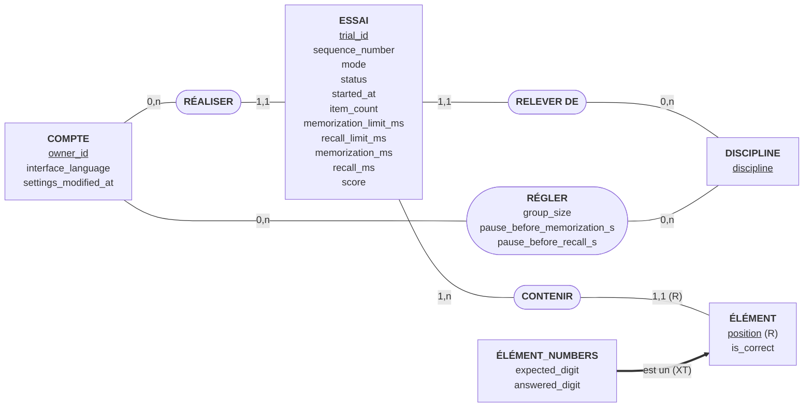
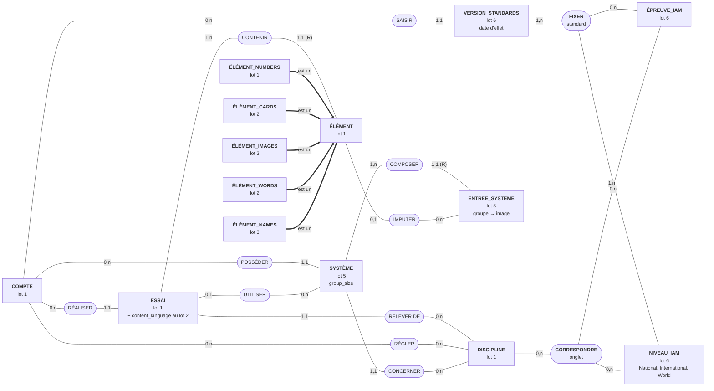

# S8 — MCD (modèle conceptuel de données)

Amont : [dictionnaire de données](dictionnaire.md), [règles de gestion](../../01-besoin/regles-de-gestion.md), [diagramme de classes](../uml/classes.md).

## En bref

- **5 entités** pour le lot 1 : **COMPTE**, **DISCIPLINE**, **ESSAI**, **ÉLÉMENT** et sa sous-entité **ÉLÉMENT_NUMBERS**.
- **4 associations** : un compte **réalise** des essais, un essai **relève** d'une discipline, un essai **contient** ses éléments, un compte **règle** chaque discipline (taille des groupes, pauses).
- **Les éléments sont spécialisés par discipline** : ÉLÉMENT porte ce qui est commun (position, juste ou non), ÉLÉMENT_NUMBERS porte les chiffres. Cards, Images, Words et Names ajouteront chacune leur sous-entité.
- Les 22 données du dictionnaire sont toutes placées, une seule fois.
- Ces trois choix de modélisation sont tracés dans l'[ADR 0015](../adr/0015-modele-conceptuel-donnees.md).
- **Une vue cible de la v1.0** (section 6, indicative) montre les 14 entités prévues après le lot 6, pour vérifier que le lot 1 ne bloque pas la suite. Elle sera détaillée avant chaque lot.

Notation Merise : rectangle = entité, forme arrondie = association (un verbe), <u>souligné</u> = identifiant, `min,max` = cardinalité (combien de fois une occurrence de l'entité participe à l'association). **(R)** = identification relative : l'élément s'identifie par son essai et sa position.

## 1. Diagramme

## 2. Entités

| Entité | Ce qu'elle représente | Identifiant | Propriétés |
|---|---|---|---|
| **COMPTE** | Le compte unique du pratiquant, créé chez Hanko. Ses paramètres généraux lui sont attachés | `owner_id` | `interface_language`, `settings_modified_at` |
| **DISCIPLINE** | Une discipline de Memory League. Une seule au lot 1 : `numbers` | `discipline` | — |
| **ESSAI** | Un essai clos : terminé, abandonné ou interrompu | `trial_id` | 11 propriétés : numéro d'ordre, mode, statut, début, format, temps utilisés, score |
| **ÉLÉMENT** | Un élément montré pendant un essai, et le résultat de sa réponse | Relatif : l'essai + `position` | `is_correct` |
| **ÉLÉMENT_NUMBERS** | Sous-entité d'ÉLÉMENT pour Numbers : le chiffre montré et le chiffre répondu | Celui d'ÉLÉMENT | `expected_digit`, `answered_digit` |

## 3. Associations

| Association | Entre | Cardinalités | Ce qu'elles disent |
|---|---|---|---|
| **RÉALISER** | COMPTE et ESSAI | COMPTE 0,n — ESSAI 1,1 | Un compte peut n'avoir aucun essai. Un essai appartient à un seul compte. |
| **RELEVER DE** | ESSAI et DISCIPLINE | ESSAI 1,1 — DISCIPLINE 0,n | Un essai relève d'une seule discipline. Une discipline peut n'avoir aucun essai. |
| **CONTENIR** | ESSAI et ÉLÉMENT | ESSAI 1,n — ÉLÉMENT 1,1 (R) | Un essai contient au moins un élément. Un élément n'existe que dans son essai. |
| **RÉGLER** | COMPTE et DISCIPLINE | COMPTE 0,n — DISCIPLINE 0,n | Pour chaque discipline réglée, le compte retient la taille des groupes et les deux pauses. L'association porte ces trois données. |

**Spécialisation** : ÉLÉMENT_NUMBERS **est un** ÉLÉMENT. La contrainte **XT** (exclusion et totalité) dit que chaque élément appartient à **une et une seule** sous-entité. Au lot 1, il n'y en a qu'une.

## 4. Contraintes que le schéma ne montre pas

Elles seront vérifiées par la base (ES07), et écrites dans le MPD (S10).

| Contrainte | Détail | Règles |
|---|---|---|
| **Bon nombre d'éléments** | Un essai contient exactement `item_count` éléments, de position 1 à `item_count`. | RG02, RG19 |
| **Bonne sous-entité** | Les éléments d'un essai de Numbers sont des ÉLÉMENT_NUMBERS, et ainsi de suite pour chaque discipline. | ADR 0014 |
| **Score cohérent** | Si l'essai est `completed`, son score égale le nombre de ses éléments justes. Sinon, score et `is_correct` sont vides. | RG12, ES07 |
| **Élément juste cohérent** | `is_correct` est vrai seulement si `answered_digit` = `expected_digit`. | RG12 |
| **Temps dans les limites** | Les temps utilisés ne dépassent pas les durées prévues. | RG01, RG08 |
| **Compte unique** | Le seul compte accepté est celui du pratiquant. | ES01, ES04 |
| **Essai immuable** | Une fois enregistré, un essai et ses éléments ne sont ni modifiés ni supprimés. | RG18, ES05 |

## 5. Volume estimé

> Estimation retenue, à mesurer sur Neon au sprint 0 : environ **14 Ko par essai Numbers** standard, index compris. Avec la spécialisation, chaque chiffre occupe deux lignes : une dans ÉLÉMENT, une dans ÉLÉMENT_NUMBERS. C'est un peu plus que les 12 Ko estimés en [S3](../contraintes-techniques.md). À 10 essais par jour, cela fait environ **50 Mo par an** : la limite de 1 Go de Neon tient encore une vingtaine d'années. Taille exacte à mesurer avec le MPD (S10).

## 6. Vue cible de la v1.0 (indicative)

Ajout demandé par le développeur, en écart léger à la spécification progressive : cette vue **ne remplace pas** la spécification de chaque lot. Elle ne montre que les entités, les associations et les cardinalités, avec une seule propriété clé quand c'est utile. Chaque partie sera détaillée, puis validée, avant son lot.

| Lot | Ce qui s'ajoute | Règles |
|---|---|---|
| **2** | Une sous-entité d'ÉLÉMENT par discipline : carte montrée et placée, image montrée et replacée, mot montré et répondu. L'essai reçoit la langue du contenu (Words). | RG03 à RG05 |
| **3** | ÉLÉMENT_NAMES : visage, prénom attendu, prénom répondu, ordre au rappel. Il sert à Names et à International Names. | RG06, RG07, RG14 |
| **4** | Rien : progression et analyse des erreurs se calculent depuis les essais et leurs éléments. | RG13, RG19 |
| **5** | SYSTÈME (taille de groupe, discipline Numbers ou Cards) et ses ENTRÉE_SYSTÈME (un groupe → une image). Un essai peut **utiliser** un système, et un élément faux peut être **imputé** à une entrée. | RG20 |
| **6** | VERSION_STANDARDS datée, dont chaque standard est **fixé** pour une épreuve IAM et un niveau. DISCIPLINE **correspond** à des épreuves IAM, par niveau et par onglet (« la plus courte », « emblématique »). Les points ne sont pas stockés : ils se calculent. | RG16, RG17 |

Les **contenus** (images, mots, prénoms, visages) ne sont pas des entités : ce sont des fichiers statiques hors de la base ([S3](../contraintes-techniques.md)). Les sous-entités des lots 2 et 3 ne gardent qu'une **référence** à chaque contenu.

> Décision : l'imputation d'une erreur à une entrée du système (IMPUTER, lot 5) est **stockée**. Elle pourrait aussi se déduire de la position et de la taille de groupe du système utilisé. À trancher avant le lot 5.

> Décision : la révision des systèmes (US17, lot 5) ne garde **aucun historique**. Si un suivi des révisions est voulu, une entité s'ajoutera.

> Décision : les standards IAM appartiennent au **compte** (SAISIR), comme le reste des données, ce qui les place sous les mêmes règles d'accès (ES04).

## Points ouverts

| Point | Pourquoi | Quand |
|---|---|---|
| **Création de la ligne COMPTE** | Le compte est créé à la main chez Hanko (ES01). La ligne COMPTE doit l'être aussi, par une migration ou au premier envoi. | S10, sprint 0 |
| **Détail des lots 2 à 6** | La vue cible (section 6) reste indicative. Chaque lot détaillera ses données au dictionnaire, puis au MCD. | Avant chaque lot |
