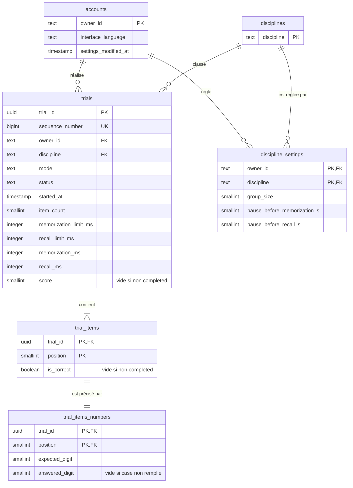

# S9 — MLD (modèle logique de données)

Amont : [MCD](mcd.md), [dictionnaire de données](dictionnaire.md).

## En bref

- **6 tables** pour le lot 1 : `accounts`, `disciplines`, `trials`, `trial_items`, `trial_items_numbers` et `discipline_settings`.
- **Une table par entité**, y compris pour la spécialisation : `trial_items` porte ce qui est commun à tous les éléments, `trial_items_numbers` porte les chiffres. Les deux partagent la même clé.
- **La clé des disciplines est leur code** (`numbers`), lisible partout.
- **Les noms de tables sont au pluriel**, en anglais. Les colonnes reprennent les codes du dictionnaire.
- Ces trois choix sont tracés dans l'[ADR 0016](../adr/0016-traduction-relationnelle.md).
- Le MLD ne traduit que le **lot 1**. La vue cible de la v1.0 reste au niveau du [MCD](mcd.md#6-vue-cible-de-la-v10-indicative).

Notation : <u>souligné</u> = clé primaire, `#` = clé étrangère. Une clé peut être les deux à la fois.

## 1. Schéma relationnel

- **accounts** (<u>owner_id</u>, interface_language, settings_modified_at)
- **disciplines** (<u>discipline</u>)
- **trials** (<u>trial_id</u>, sequence_number, #owner_id, #discipline, mode, status, started_at, item_count, memorization_limit_ms, recall_limit_ms, memorization_ms, recall_ms, score)
- **trial_items** (<u>#trial_id, position</u>, is_correct)
- **trial_items_numbers** (<u>#trial_id, #position</u>, expected_digit, answered_digit)
- **discipline_settings** (<u>#owner_id, #discipline</u>, group_size, pause_before_memorization_s, pause_before_recall_s)

## 2. Diagramme

Les types sont **logiques** : le MPD (S10) fixera les types exacts de PostgreSQL et les contraintes.

## 3. Passage du MCD au MLD

| Élément du MCD | Règle de passage | Résultat dans le MLD |
|---|---|---|
| Entité **COMPTE** | Une entité devient une table | `accounts`, clé `owner_id` |
| Entité **DISCIPLINE** | Une entité devient une table | `disciplines`, clé `discipline` (le code) |
| Entité **ESSAI** | Une entité devient une table | `trials`, clé `trial_id`. `sequence_number` est unique. |
| **RÉALISER** (ESSAI 1,1) | La table du côté 1,1 reçoit la clé de l'autre entité | `trials.owner_id` → `accounts` |
| **RELEVER DE** (ESSAI 1,1) | Même règle | `trials.discipline` → `disciplines` |
| Entité **ÉLÉMENT** + **CONTENIR** (1,1, identification relative) | La clé de l'essai entre dans la clé de l'élément | `trial_items`, clé (`trial_id`, `position`) |
| Sous-entité **ÉLÉMENT_NUMBERS** | Une table par sous-entité, avec la clé de l'entité générale | `trial_items_numbers`, clé (`trial_id`, `position`) → `trial_items` |
| **RÉGLER** (0,n — 0,n, porteuse de données) | L'association devient une table, dont la clé réunit les deux clés | `discipline_settings`, clé (`owner_id`, `discipline`) |

## 4. Clés et liens

| Table | Clé primaire | Clés étrangères | Unicité |
|---|---|---|---|
| **accounts** | `owner_id` | — | — |
| **disciplines** | `discipline` | — | — |
| **trials** | `trial_id` | `owner_id` → `accounts`, `discipline` → `disciplines` | `sequence_number` |
| **trial_items** | `trial_id`, `position` | `trial_id` → `trials` | — |
| **trial_items_numbers** | `trial_id`, `position` | (`trial_id`, `position`) → `trial_items` | — |
| **discipline_settings** | `owner_id`, `discipline` | `owner_id` → `accounts`, `discipline` → `disciplines` | — |

Les contraintes de valeurs (bornes, listes, cohérence du score) sont dans le [dictionnaire](dictionnaire.md) et la section 4 du [MCD](mcd.md#4-contraintes-que-le-schéma-ne-montre-pas). Elles seront écrites dans le MPD.

## Points ouverts

| Point | Pourquoi | Quand |
|---|---|---|
| **Contrainte XT et bonne sous-table** | La base doit garantir qu'un élément d'un essai Numbers a sa ligne dans `trial_items_numbers`, et une seule. Une clé étrangère ne suffit pas : contrôle dans la fonction d'envoi ([ADR 0010](../adr/0010-envoi-essai-fonction-sql.md)) ou par un déclencheur. | S10 |
| **Règles d'accès sur les éléments** | `trial_items` et `trial_items_numbers` n'ont pas de colonne `owner_id` : leurs règles RLS doivent passer par l'essai. | S11 |
| **Index** | Lecture par numéro d'ordre (synchronisation, sauvegarde) et par discipline (historique). | S10 |
