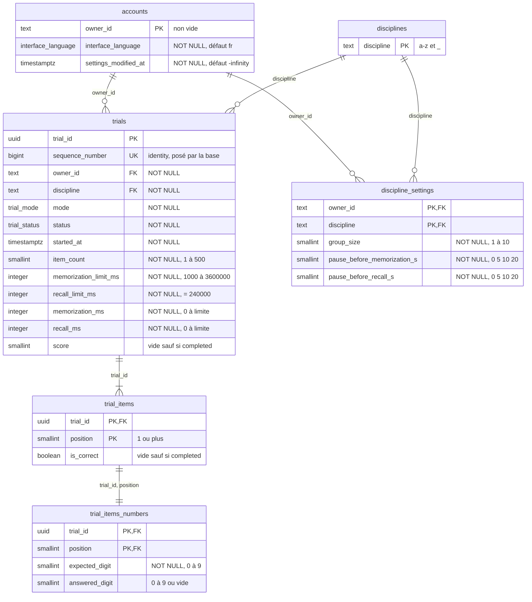

# S10 — MPD (modèle physique de données)

Amont : [MLD](mld.md), [MCD](mcd.md), [dictionnaire de données](dictionnaire.md), ADR [0010](../adr/0010-envoi-essai-fonction-sql.md), [0011](../adr/0011-repere-numero-ordre-verrou.md) et [0012](../adr/0012-conflits-parametres-heure-appareil.md).

## En bref

- **Le modèle physique du lot 1**, pour **PostgreSQL 16** (Neon) : vue d'ensemble des tables, index, déclencheurs et fonctions.
- **Le détail de chaque colonne** (type PostgreSQL, vide permis, défaut, contraintes) et les **types ENUM** sont dans le [dictionnaire de données](dictionnaire.md), source unique sur chaque donnée.
- **Les contrôles sur plusieurs lignes passent par des déclencheurs différés**, vérifiés à la fin de chaque transaction et quel que soit le chemin d'écriture : bon nombre d'éléments, une ligne de sous-table par élément, score et « juste » cohérents.
- **Un déclencheur refuse toute modification ou suppression d'un essai**, pour tous les rôles, en plus des droits (RG18, ES05).
- **Le compte autorisé est créé par la CI**, depuis un secret : aucun identifiant réel dans le repo (ES10).
- **Le script SQL** qui traduit ce modèle est un fichier local, ignoré par git : `bdd/schema.sql`. Il a été exécuté et testé sur PostgreSQL 16 (section 8).
- Les rôles, les droits et les règles RLS sont en **S11**. Ces choix sont tracés dans l'[ADR 0017](../adr/0017-integrite-base-donnees.md).

## 1. Diagramme

## 2. Colonnes et types

Le détail de chaque colonne (type PostgreSQL, vide permis, valeur par défaut, contraintes) et les valeurs des types ENUM sont dans le [dictionnaire de données](dictionnaire.md), source unique sur chaque donnée. Le diagramme ci-dessus en donne la vue d'ensemble.

Les types `smallint` (2 octets) suffisent pour toutes les valeurs bornées à 500 ou moins. Les durées en millisecondes dépassent 32 767 : elles sont en `integer`.

## 3. Index

Aucun index en plus de ceux créés par les clés primaires et l'unicité :

| Index | Créé par | Sert à |
|---|---|---|
| `trials (trial_id)` | Clé primaire | Détection des doublons à l'envoi (ES06) |
| `trials (sequence_number)` | Unicité | Réception et sauvegarde par numéro d'ordre (ADR 0011) |
| `trial_items (trial_id, position)` | Clé primaire | Lecture des éléments d'un essai |
| `trial_items_numbers (trial_id, position)` | Clé primaire | Jointure avec `trial_items` |
| `discipline_settings (owner_id, discipline)` | Clé primaire | Lecture et mise à jour des réglages |

L'historique et les statistiques se lisent sur l'appareil, pas dans Neon : ils ne demandent aucun index.

## 4. Déclencheurs

| Déclencheur | Sur | Quand | Rôle | Règles |
|---|---|---|---|---|
| **trials_integrity**, **trial_items_integrity**, **trial_items_numbers_integrity** | Les 3 tables d'essai | Après chaque insertion, **contrôle différé** à la fin de la transaction | Vérifie l'essai entier : `item_count` éléments de 1 à `item_count`, une ligne de `trial_items_numbers` par élément, `is_correct` cohérent, score = nombre de justes | RG12, RG19, ES07, contrainte XT |
| **trials_immutable**, **trial_items_immutable**, **trial_items_numbers_immutable** | Les 3 tables d'essai | Avant chaque modification ou suppression | Refuse, quel que soit le rôle | RG18, ES05 |
| **…_no_truncate** | Les 3 tables d'essai | Avant un vidage de table | Refuse | RG18, ES05 |

Le contrôle différé tourne une fois par ligne insérée, soit 161 fois pour un essai de 80 chiffres, et lit au plus 160 lignes à chaque fois : quelques millisecondes en tout.

## 5. Fonctions appelées par l'application

L'identité vient du jeton, par `auth.user_id()`, fournie par Neon. Les droits d'exécution sont dans l'[accès aux données](../acces.md) (S11).

| Fonction | S'exécute avec | Reçoit | Renvoie | Ce qu'elle fait | Décisions |
|---|---|---|---|---|---|
| **submit_trial** | Les droits de l'appelant, sous RLS | L'essai clos et ses éléments, en JSON | `inserted` ou `duplicate` ; une erreur si une valeur est refusée | Prend le verrou du numéro d'ordre, ignore un essai déjà reçu, pose le propriétaire depuis le jeton, insère l'essai, ses éléments et leurs chiffres | ADR 0010, 0011 |
| **save_settings** | Les droits du propriétaire des tables (seul chemin d'écriture des paramètres) | Les paramètres, leur heure de modification et les réglages par discipline, en JSON | `saved` ou `ignored` | Ne remplace les paramètres que si l'heure reçue est plus récente, puis met à jour chaque discipline. Ne touche que la ligne de l'identité du jeton | ADR 0012, 0018 |

## 6. Données initiales

| Donnée | Comment |
|---|---|
| Ligne `numbers` de `disciplines` | Dans le script |
| Ligne du compte dans `accounts` | Migration à part, exécutée par la CI avec l'identifiant Hanko tiré d'un **secret GitHub** (ES09, ES10). Une clé étrangère bloque ensuite tout autre compte (ES01). |
| Règles RLS | Activées sur les 6 tables : tout est refusé, sauf ce que l'[accès aux données](../acces.md) autorise (ES04) |

## 7. Où est appliquée chaque contrainte du MCD

| Contrainte (MCD, section 4) | Mécanisme |
|---|---|
| **Bon nombre d'éléments** | Déclencheur différé |
| **Bonne sous-entité** (XT) | Déclencheur différé : une ligne de `trial_items_numbers` par élément |
| **Score cohérent** | `CHECK` (présent si `completed`) et déclencheur différé (égal au nombre de justes) |
| **Élément juste cohérent** | Déclencheur différé |
| **Temps dans les limites** | `CHECK` sur `trials` |
| **Compte unique** | Clés étrangères vers `accounts`, qui ne contient que le compte créé par la CI |
| **Essai immuable** | Déclencheurs avant modification, suppression et vidage, plus les droits (S11) |
| **Bornes et listes** du dictionnaire | `CHECK` et types ENUM |

## 8. Tests du script

Le script `bdd/schema.sql` a été exécuté le 2026-11-20 sur **PostgreSQL 16.4** (PGlite), avec une fonction `auth.user_id()` simulée. Les 14 cas donnent le résultat attendu :

| Cas testé | Attendu | Obtenu |
|---|---|---|
| Essai Numbers complet et cohérent | Accepté | `inserted` |
| Même essai envoyé deux fois | Un seul essai en base | `duplicate`, 1 essai |
| 79 éléments au lieu de 80 | Refusé | Refusé : 80 attendus, 79 trouvés |
| Score différent du nombre de justes | Refusé | Refusé : score 71, 70 justes |
| Élément marqué juste avec une réponse fausse | Refusé | Refusé : `is_correct` incohérent |
| Chiffre 12 | Refusé | Refusé : contrainte `CHECK` |
| Essai abandonné, sans score ni « juste » | Accepté | `inserted` |
| Essai d'un compte inconnu | Refusé | Refusé : clé étrangère vers `accounts` |
| Modification d'un essai | Refusée | Refusée : essai immuable |
| Suppression d'éléments | Refusée | Refusée : essai immuable |
| Vidage des tables | Refusé | Refusé : essai immuable |
| Élément ajouté directement à un essai existant | Refusé | Refusé : 80 attendus, 81 trouvés |
| Paramètres plus récents, puis plus anciens | `saved`, puis `ignored` | `saved`, puis `ignored`, la valeur récente est gardée |
| Numéros d'ordre de deux essais acceptés | Croissants | 1 puis 6 : croissants, avec des trous laissés par les essais refusés (attendu, ADR 0011) |

**Volume** : les lignes d'un essai de 80 chiffres occupent environ **7 Ko** de données. Avec les index et les en-têtes, l'estimation de 12 à 14 Ko reste valable ; la mesure exacte sera refaite sur Neon.

## Points ouverts

| Point | Pourquoi | Quand |
|---|---|---|
| ~~**`auth.user_id()` chez Neon**~~ | Vérifié au sprint 0 : même nom, renvoie du texte ; migration appliquée sur la branche `dev` (PostgreSQL 18). | Fait |
| **Volume sur Neon** | Mesurer la taille réelle d'un essai, index compris : il faut un premier vrai essai. | Lot 1 |
