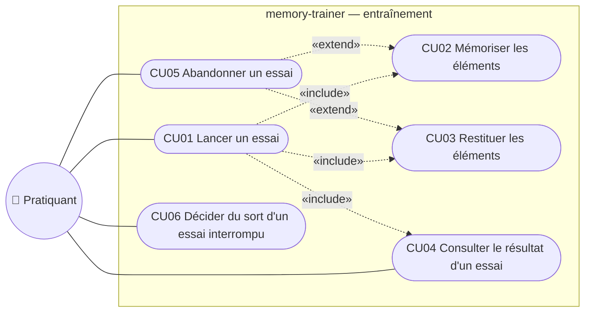
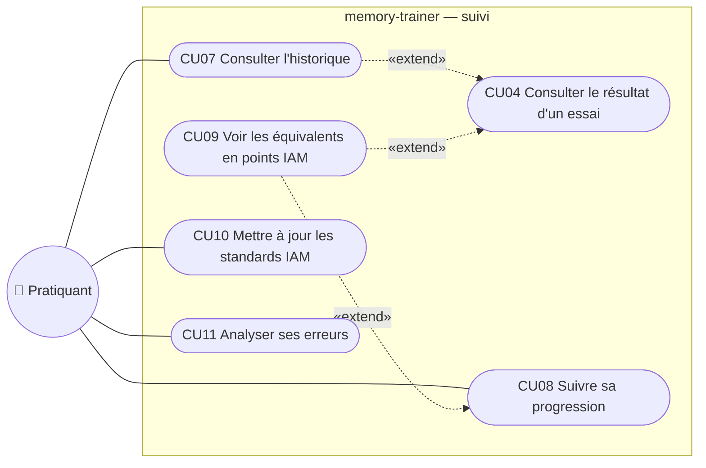
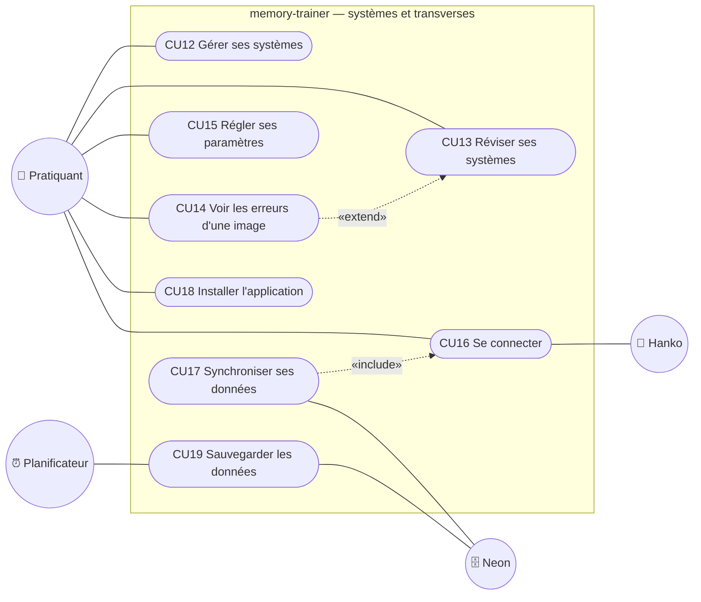

# S4 — Diagramme de cas d'utilisation

Amont : [persona](../../01-besoin/persona.md), [exigences](../../01-besoin/exigences.md), [user stories](../../01-besoin/user-stories.md), [périmètre et lots](../../02-projet/perimetre.md), [architecture](../architecture.md).

## En bref

- **Un seul acteur humain** : le pratiquant. Trois acteurs secondaires : **Hanko** (connexion), **Neon** (données de référence) et le **planificateur** Cloudflare (sauvegarde).
- **19 cas d'utilisation**, de **CU01** à **CU19**, chacun relié à ses user stories et à son lot.
- Le diagramme est découpé en trois vues : **entraînement**, **suivi**, **systèmes et transverses**.
- **12 fiches détaillées** pour les cas du lot 1 (acteurs, préconditions, scénarios, postconditions). Les autres seront rédigées avant leur lot.
- **4 décisions** prises lors de la rédaction des fiches (CU01, CU05, CU06, CU15) : rappel de 4 minutes en mode personnalisé, abandon sans annulation, statut « Erreur externe » conservé, paramètres synchronisés.
- **Temps de préparation** avant la mémorisation et avant le rappel (RG25, US23) : intégré à CU01, CU02, CU03 et CU05, avec 2 décisions dans CU01.

## Acteurs

| Acteur | Type | Rôle |
|---|---|---|
| **Pratiquant** | Humain, principal | Le développeur, seul utilisateur ([persona](../../01-besoin/persona.md)) |
| **Hanko** | Système externe | Vérifie la passkey et délivre le jeton de session |
| **Neon** | Système externe | Garde la copie de référence des données |
| **Planificateur** | Système externe | Déclenche la sauvegarde quotidienne (Worker Cloudflare) |

## 1. Entraînement

## 2. Suivi

## 3. Systèmes et transverses

CU17 est déclenché **automatiquement** par l'application (à l'ouverture, au retour du réseau), pas par le pratiquant.

## Liste des cas d'utilisation

| Cas d'utilisation | Description | User stories | Exigences | Lot |
|---|---|---|---|---|
| **CU01** : Lancer un essai | Choisir la discipline, le mode (standard ou personnalisé), la langue et les temps de préparation, puis démarrer. | US01 à US06, US09, US23 | EF01 à EF07, EF23 | 1, puis 2 et 3 |
| **CU02** : Mémoriser les éléments | Parcourir les éléments par groupes, arrêter le chronomètre plus tôt, puis pause avant le rappel. | US07, US23 | EF08, EF23 | 1 |
| **CU03** : Restituer les éléments | Saisir le rappel, avec insertion et suppression. | US08 | EF09 | 1 |
| **CU04** : Consulter le résultat d'un essai | Score, temps, éléments attendus face aux réponses. | US11 | EF10, EF12 | 1 |
| **CU05** : Abandonner un essai | Choisir entre « Garder hors statistiques », « Compter tel quel » et « Ne pas garder ». | US10 | EF11 | 1 |
| **CU06** : Décider du sort d'un essai interrompu | À la réouverture, choisir le sort d'un essai interrompu par un incident extérieur. | US10 | EF11 | 1 |
| **CU07** : Consulter l'historique | Lister tous les essais, filtrer par discipline et par mode. | US12 | EF13 | 1 |
| **CU08** : Suivre sa progression | Meilleure performance, moyenne récente, courbes. | US13 | EF14 | 4 |
| **CU09** : Voir les équivalents en points IAM | Points National, International et World, dans deux onglets. | US14 | EF15 | 6 |
| **CU10** : Mettre à jour les standards IAM | Saisir une nouvelle version datée des standards. | US14 | EF15 | 6 |
| **CU11** : Analyser ses erreurs | Éléments ratés, positions fautives, confusions, sur une période. | US15 | EF16 | 4 |
| **CU12** : Gérer ses systèmes | Créer, consulter et modifier un système d'images. | US16 | EF17 | 5 |
| **CU13** : Réviser ses systèmes | Retrouver l'image associée à un élément. | US17 | EF18 | 5 |
| **CU14** : Voir les erreurs d'une image | Erreurs imputées à une image, révision ciblée. | US18 | EF19 | 5 |
| **CU15** : Régler ses paramètres | Langue de l'interface, motif d'affichage et pauses par épreuve. | US19, US07 | EF20, EF08 | 1 |
| **CU16** : Se connecter | Connexion par passkey auprès de Hanko. | US21 | ES01 à ES03 | 1 |
| **CU17** : Synchroniser ses données | Envoyer les essais en attente, recevoir ceux des autres appareils. | US20, US21 | EF21 | 1 |
| **CU18** : Installer l'application | Installer la PWA sur ordinateur, téléphone ou tablette. | US22 | EF22 | 1 (mobile), 7 (bureau) |
| **CU19** : Sauvegarder les données | Export quotidien et incrémental vers R2. | — | ES17, ES18 | 1 |

CU18 et CU19 n'ont pas de user story propre :
- l'installation sur téléphone et tablette découle de S3 : sur iPhone et iPad, elle est nécessaire pour garder les données locales ;
- la sauvegarde découle de ES17.

Ces deux cas seront vérifiés par des tests de recette (Q2).

## Fiches des cas d'utilisation du lot 1

Une fiche par cas du lot 1. Les fiches des autres lots seront rédigées juste avant leur développement (spécification progressive). Au lot 1, la seule discipline est **Numbers**.

### CU01 — Lancer un essai

| | |
|---|---|
| **Acteur** | Pratiquant |
| **Préconditions** | L'application est ouverte. La connexion n'est pas nécessaire. Aucun essai interrompu n'attend de décision (sinon : CU06 d'abord). |
| **Postconditions** | La pause avant la mémorisation est passée. Rien n'est encore enregistré : l'essai « en cours » l'est au démarrage du chronomètre (CU02). |

**Scénario nominal**
1. Le pratiquant choisit la discipline Numbers.
2. Il choisit le mode **standard** (80 chiffres, 1 minute de mémorisation, 4 minutes de rappel : RG01, RG02).
3. Il choisit la durée des deux pauses : 0, 5, 10 ou 20 s. Les dernières utilisées pour Numbers sont proposées (RG25).
4. L'application tire une nouvelle suite aléatoire (RG21) et prépare l'affichage avant de démarrer le chronomètre (ENF08).
5. La pause avant la mémorisation commence : seul un compte à rebours s'affiche, les chiffres sont cachés (RG25).
6. À la fin du compte à rebours, l'essai démarre : CU02.

**Scénarios alternatifs**
- **2a. Mode personnalisé** : le pratiquant règle la durée de mémorisation et le nombre de chiffres (RG15), puis reprend à l'étape 3.
- **5a. Pause de 0 s** : pas de compte à rebours, l'essai démarre directement : CU02.
- **5b. Pause écourtée** : le pratiquant écourte la pause, l'essai démarre aussitôt : CU02.
- **5c. Abandon pendant la pause** : retour à l'accueil. Rien n'est enregistré, aucune question n'est posée (RG25).
- **5d. Interruption pendant la pause** (onglet fermé, batterie vide) : rien n'ayant été enregistré, aucun essai n'est à décider à la réouverture.

Décision : en mode personnalisé, la durée de rappel reste de **4 minutes**, conformément à RG15.

Décision : l'essai « en cours » est enregistré au **démarrage de la mémorisation**, et non au lancement. Une interruption pendant la pause avant la mémorisation ne laisse donc rien à décider (5d), comme l'abandon sans question (5c).

Décision : les dernières durées de pause utilisées pour chaque épreuve sont gardées **avec les paramètres**, et donc synchronisées entre les appareils comme eux ([ADR 0012](../adr/0012-conflits-parametres-heure-appareil.md)).

### CU02 — Mémoriser les éléments

| | |
|---|---|
| **Acteur** | Pratiquant |
| **Préconditions** | Un essai vient d'être lancé, et la pause avant la mémorisation est passée (CU01). |
| **Postconditions** | Le temps de mémorisation réellement utilisé est enregistré, à la milliseconde (RG08, ENF01). La pause avant le rappel est passée. |

**Scénario nominal**
1. Le chronomètre de mémorisation démarre. L'essai « en cours » est enregistré sur l'appareil, ce qui permet de détecter une interruption (RG24).
2. L'application affiche le premier groupe de chiffres, découpé selon le motif d'affichage réglé dans les paramètres, par exemple « 45 83 » pour le motif « 2 2 » (RG11, CU15).
3. Le pratiquant navigue : → avance d'un groupe, ← recule, barre d'espace ou ↑ revient au début (RG09). Sur écran tactile, des équivalents sont proposés (maquettes, S12).
4. Le pratiquant termine : → deux fois rapidement à la fin des éléments, bouton **Finished** ou touche Entrée (RG09).
5. Le chronomètre s'arrête. La pause avant le rappel commence : seul un compte à rebours s'affiche, les chiffres sont cachés (RG25).
6. À la fin du compte à rebours, le rappel commence : CU03.

**Scénarios alternatifs**
- **4a. Temps écoulé** : à la fin de la durée de mémorisation, le chronomètre s'arrête seul et la pause avant le rappel commence (RG01).
- **4b. Abandon** : CU05.
- **5a. Pause de 0 s ou écourtée** : le rappel commence directement : CU03.
- **5b. Abandon pendant la pause** : CU05.

### CU03 — Restituer les éléments

| | |
|---|---|
| **Acteur** | Pratiquant |
| **Préconditions** | La mémorisation et la pause avant le rappel sont terminées (CU02). |
| **Postconditions** | L'essai est **terminé**, corrigé, enregistré sur l'appareil et **ajouté à la file d'envoi**. Il ne peut plus être modifié (RG18). |

**Scénario nominal**
1. Le chronomètre de rappel démarre (4 minutes).
2. Le pratiquant sélectionne une case et tape un chiffre. Retour arrière efface la case sélectionnée si elle est remplie, sinon le chiffre à gauche. **+** insère une case vide et décale la suite (le dernier chiffre sort de la grille) ; **−** supprime la case et ramène la suite (RG10).
3. Le pratiquant valide son rappel avec le bouton **Finished**.
4. L'application corrige : 1 point par chiffre juste à la bonne position, sans pénalité (RG12).
5. L'essai est enregistré et ajouté à la file d'envoi, puis le résultat s'affiche : CU04.

**Scénarios alternatifs**
- **3a. Temps écoulé** : à la fin des 4 minutes, le rappel s'arrête seul et la correction se fait avec les réponses saisies.
- **3b. Abandon** : CU05.

### CU04 — Consulter le résultat d'un essai

| | |
|---|---|
| **Acteur** | Pratiquant |
| **Préconditions** | L'essai est terminé (CU03), ou il est ouvert depuis l'historique (CU07). |
| **Postconditions** | Aucune : simple consultation. |

**Scénario nominal**
1. L'application affiche le score, le temps de mémorisation et le temps de rappel, au centième de seconde (ENF01).
2. Elle affiche chaque chiffre attendu face à la réponse donnée. Les erreurs sont mises en évidence (RG19).

Décision : un essai ouvert depuis l'historique s'affiche avec le **motif d'affichage actuel** des paramètres. Le motif n'est pas enregistré avec l'essai, et il ne change que l'espacement des cases, jamais la correction.

### CU05 — Abandonner un essai

| | |
|---|---|
| **Acteur** | Pratiquant |
| **Préconditions** | Un essai est en mémorisation (CU02), en pause avant le rappel (CU02) ou en rappel (CU03). Un abandon pendant la pause avant la mémorisation ne passe pas par ce cas : voir CU01, 5c (RG25). |
| **Postconditions** | Selon le choix : essai enregistré comme abandonné, essai compté normalement, ou rien d'enregistré (RG23). |

**Scénario nominal**
1. Le pratiquant demande à abandonner. Les chronomètres s'arrêtent. La demande est **définitive** : on ne peut pas revenir à l'essai.
2. L'application propose trois choix (RG23).
3. **Garder hors statistiques** : l'essai est enregistré avec le statut « abandonné ». Il apparaît dans l'historique, mais pas dans les statistiques, et il est ajouté à la file d'envoi.

**Scénarios alternatifs**
- **3a. Compter tel quel** : l'essai est corrigé avec les réponses déjà saisies, enregistré comme un essai normal et ajouté à la file d'envoi. Puis CU04.
- **3b. Ne pas garder** : l'essai en cours est effacé de l'appareil. Rien n'est enregistré ni envoyé.

Décision : pas d'annulation possible. Les trois choix sont la seule issue d'une demande d'abandon.

### CU06 — Décider du sort d'un essai interrompu

| | |
|---|---|
| **Acteur** | Pratiquant |
| **Déclencheur** | Ouverture de l'application alors qu'un essai « en cours » n'a jamais été terminé (onglet fermé, batterie vide, plantage). |
| **Postconditions** | L'essai a un sort définitif. **Il n'est jamais envoyé avant cette décision**, ce qui évite d'avoir à supprimer un essai côté serveur (ES05). |

**Scénario nominal**
1. L'application détecte l'essai et lui donne le statut « Erreur externe à l'application » (RG24).
2. Elle propose les trois choix de RG23.
3. **Garder hors statistiques** : l'essai est enregistré avec le statut « Erreur externe à l'application », exclu des statistiques, et ajouté à la file d'envoi.

**Scénarios alternatifs**
- **3a. Compter tel quel** : l'essai est corrigé avec les réponses saisies avant l'interruption, puis compté normalement.
- **3b. Ne pas garder** : l'essai est effacé de l'appareil.

Décision : un essai interrompu gardé hors statistiques **conserve le statut « Erreur externe à l'application »**, pour distinguer un incident d'un abandon volontaire.

### CU07 — Consulter l'historique

| | |
|---|---|
| **Acteur** | Pratiquant |
| **Préconditions** | Aucune. L'historique se lit sur l'appareil, même hors ligne. |
| **Postconditions** | Aucune : simple consultation. |

**Scénario nominal**
1. L'application liste tous les essais, du plus récent au plus ancien.
2. Les essais personnalisés se reconnaissent à un code couleur (RG15). Les essais abandonnés ou interrompus sont visibles et signalés.
3. Le pratiquant filtre par discipline et par mode.
4. Il ouvre un essai : CU04.

**Scénarios alternatifs**
- **1a. Aucun essai** : l'application invite à lancer un premier essai (CU01).

### CU15 — Régler ses paramètres

| | |
|---|---|
| **Acteur** | Pratiquant |
| **Préconditions** | Aucune. |
| **Postconditions** | Les réglages sont enregistrés et s'appliquent aux essais suivants. |

**Scénario nominal**
1. Le pratiquant choisit la langue de l'interface : français ou anglais (EF20). L'interface change sans recharger les données.
2. Il construit le motif d'affichage de chaque épreuve : 1 à 3 sous-groupes de 1 à 5 éléments, par exemple « 2 3 » pour Numbers, avec un aperçu (RG11). « 2 » par défaut pour Numbers.
3. Il choisit les deux pauses de préparation de chaque épreuve : 0, 5, 10 ou 20 s (RG25).

Décision : les **pauses de préparation** de chaque épreuve sont aussi un paramètre. C'est **une seule valeur** : la modifier ici ou au lancement d'un essai (CU01) change la même valeur, celle qui est proposée au lancement suivant (RG25). Sur un appareil neuf, il n'y a **aucune pause** (0 s et 0 s).

Décision : les paramètres sont **synchronisés entre les appareils**, comme les essais. Ils sont donc modifiables, contrairement aux essais : en cas de modification sur deux appareils, **la dernière modification l'emporte**.

### CU16 — Se connecter

| | |
|---|---|
| **Acteurs** | Pratiquant ; Hanko |
| **Déclencheur** | Premier lancement sur un appareil, ou session expirée au moment de synchroniser (CU17). |
| **Préconditions** | Le réseau est disponible. Le compte unique existe, créé à la main (ES01). |
| **Postconditions** | L'application détient un jeton de session valide (JWT). |

**Scénario nominal**
1. L'application affiche la connexion Hanko.
2. Le pratiquant choisit sa passkey et la valide avec le déverrouillage de l'appareil (Face ID, Touch ID, Windows Hello, code).
3. Hanko vérifie la passkey et renvoie un jeton de session.
4. La synchronisation démarre : CU17.

**Scénarios alternatifs**
- **Hors ligne** : l'application reste utilisable avec les données de l'appareil. La connexion est reportée au retour du réseau (S3).
- **Nouvel appareil sans passkey** : la passkey est partagée par le gestionnaire de mots de passe du système, ou utilisée depuis un autre appareil en scannant un QR code.
- **Échec** : l'application affiche l'erreur. Les données locales restent intactes.

### CU17 — Synchroniser ses données

| | |
|---|---|
| **Acteurs** | Application (déclenchement automatique) ; Neon |
| **Déclencheur** | Ouverture de l'application, retour du réseau, fin d'un essai, ou intervalle régulier tant que l'application est ouverte (S3). |
| **Préconditions** | Le réseau est disponible et la session est valide (sinon : CU16). |
| **Postconditions** | La file d'envoi est vide. L'appareil a reçu les essais faits sur les autres appareils. |

**Scénario nominal**
1. L'application envoie chaque essai de la file d'envoi, avec son identifiant unique créé sur l'appareil.
2. Neon enregistre l'essai, ou l'ignore s'il l'a déjà reçu (RG22, ES06).
3. L'essai est retiré de la file d'envoi.
4. L'application télécharge les essais reçus par Neon depuis sa dernière synchronisation, et les ajoute à la base de l'appareil.

**Scénarios alternatifs**
- **1a. Réseau perdu en cours de route** : les essais non confirmés restent dans la file d'envoi. La synchronisation reprendra plus tard, sans doublon.
- **1b. Session expirée** : CU16, puis reprise à l'étape 1.
- **Essai en cours ou interrompu** : il n'entre jamais dans la file d'envoi (CU06).

### CU18 — Installer l'application

| | |
|---|---|
| **Acteur** | Pratiquant |
| **Préconditions** | L'application est ouverte dans un navigateur compatible (S3). |
| **Postconditions** | L'application a son icône et sa propre fenêtre. Elle a demandé un stockage persistant. |

**Scénario nominal**
1. Le pratiquant installe l'application : sur iPhone et iPad, Safari, puis « Partager » et « Sur l'écran d'accueil » ; ailleurs, l'option « Installer » du navigateur.
2. Au premier lancement de l'application installée, elle demande un stockage persistant (S3).

**Scénarios alternatifs**
- **iPhone ou iPad sans installation** : l'application affiche un rappel, car sans installation, Safari peut effacer les données locales.
- **Firefox sur ordinateur** : l'installation n'est pas possible ; l'application reste utilisable dans un onglet.

### CU19 — Sauvegarder les données

| | |
|---|---|
| **Acteurs** | Planificateur (Worker Cloudflare) ; Neon |
| **Déclencheur** | Chaque jour, à heure fixe. |
| **Préconditions** | Le Worker dispose d'un accès à la base **en lecture seule** et d'un accès en écriture à R2 (ES11). |
| **Postconditions** | Les essais reçus depuis la dernière sauvegarde sont dans R2, en JSON. |

**Scénario nominal**
1. Le Worker lit le repère de la dernière sauvegarde réussie.
2. Il lit dans Neon les essais reçus depuis ce repère, ainsi que les paramètres.
3. Il écrit un fichier JSON daté dans R2, dans un espace privé.
4. Il met à jour le repère.

**Scénarios alternatifs**
- **Échec** (Neon en veille trop longue, erreur réseau) : le repère n'est pas mis à jour. La sauvegarde suivante reprend depuis le dernier repère réussi : rien n'est perdu. L'échec est visible dans le tableau de bord Cloudflare.
