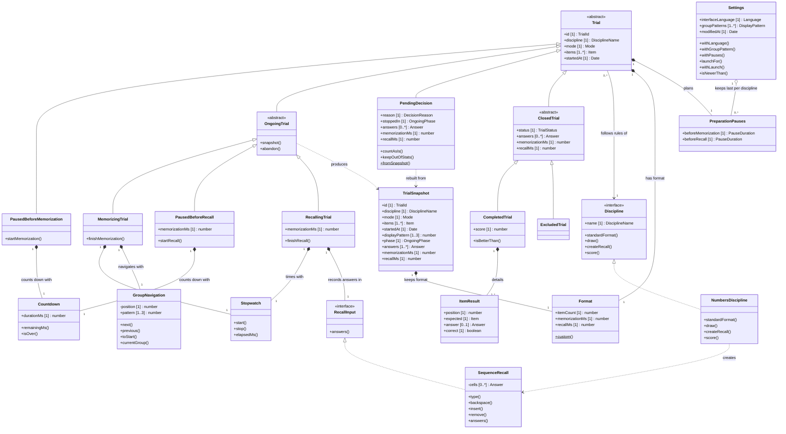
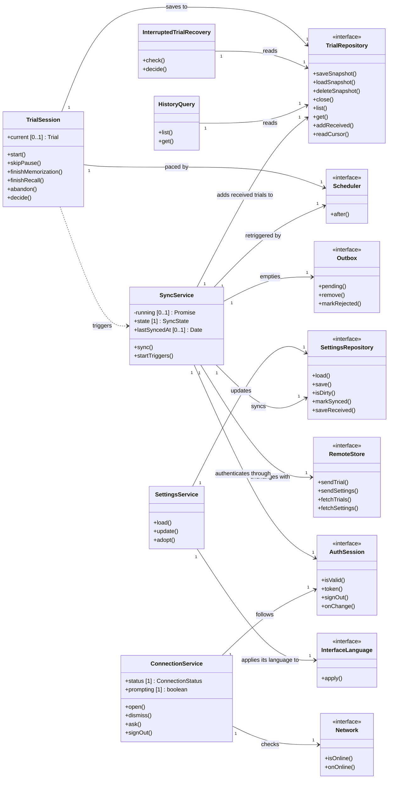
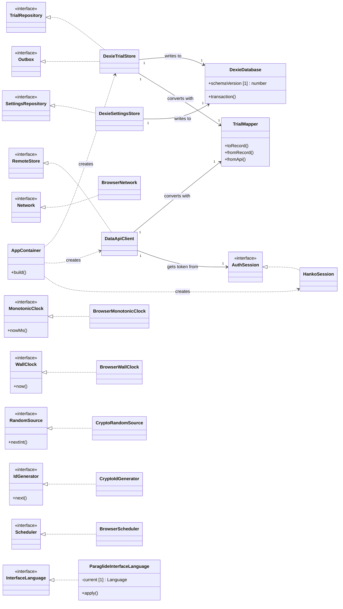

# S6 — Diagramme de classes

Amont : [architecture](../architecture.md), [séquences](sequences.md), [cas d'utilisation](cas-utilisation.md), [règles de gestion](../../01-besoin/regles-de-gestion.md), [conventions](../../02-projet/conventions.md).

## En bref

- **Le diagramme modélise le code du lot 1**, pas la base de données (le MCD viendra en S8). Seule la discipline Numbers est détaillée.
- **Le métier est écrit en classes**, et un essai est une **machine à états** : chaque phase a sa propre classe, qui n'offre que les actions permises. Démarrer le rappel avant la fin de la pause ne peut donc pas s'écrire : le code ne compile pas.
- **Une interface `Discipline`** regroupe ce qui change d'une discipline à l'autre (tirage, saisie, correction). Numbers en est la première implémentation, les autres disciplines s'y ajouteront aux lots 2 et 3.
- **La couche Application ne connaît que des interfaces** (dépôt d'essais, serveur, session, horloges). Dexie.js, la Data API et Hanko les implémentent dans l'Infrastructure. Les tests utilisent de fausses implémentations en mémoire.
- Ces quatre choix sont tracés dans l'[ADR 0013](../adr/0013-organisation-code-metier.md).
- **Les diagrammes sont en anglais** : ce sont les noms du code (P7). Les explications restent en français.

Notation : `[1]` un seul, `[0..1]` zéro ou un, `[0..*]` zéro ou plusieurs, `[1..*]` au moins un. Losange plein : composition (la partie n'existe pas sans le tout). Losange vide : agrégation. Triangle vide : héritage (trait plein) ou implémentation d'une interface (pointillés).

## 1. Diagramme de classes du métier

| Classe | Rôle | Règles |
|---|---|---|
| **Trial** | Ce que toutes les phases partagent : identifiant créé sur l'appareil, discipline, mode, éléments tirés, date de début | RG19, RG21, RG22 |
| **PausedBeforeMemorization** | Compte à rebours avant la mémorisation, éléments cachés | RG25 |
| **OngoingTrial** | Phases qu'on peut abandonner ou interrompre. `snapshot()` produit l'enregistrement fait toutes les 2 s (SEQ02) | RG23, RG24 |
| **MemorizingTrial** | Chronomètre et navigation par groupes. `finishMemorization()` plafonne le temps à la durée du format | RG01, RG08, RG09, RG11 |
| **PausedBeforeRecall** | Compte à rebours avant le rappel. Le temps de mémorisation est figé | RG25 |
| **RecallingTrial** | Chronomètre de rappel et saisie. `finishRecall()` fait corriger l'essai par la discipline | RG10, RG12 |
| **PendingDecision** | Attente des trois choix, après un abandon ou une interruption. `stoppedIn` garde la phase de l'arrêt, affichée dans la fenêtre de l'essai interrompu. `fromSnapshot()` reconstruit un essai interrompu | RG23, RG24 |
| **ClosedTrial** | Essai clos, sans aucune méthode de modification | RG18 |
| **CompletedTrial** | Essai compté. `isBetterThan()` compare d'abord le score, puis le temps de mémorisation | RG12, RG13 |
| **ExcludedTrial** | Essai hors statistiques : statut « abandonné » ou « Erreur externe à l'application » | RG23, RG24 |
| **ItemResult** | Un élément attendu face à la réponse donnée | RG12, RG19 |
| **TrialSnapshot** | Valeur simple enregistrée dans Dexie.js pendant l'essai : tout ce qu'il faut pour reconstruire l'essai (éléments, format, motif d'affichage), sa phase, les réponses et les temps du moment. Sans les pauses, jamais enregistrées (RG25) | RG24, RG25 |
| **Format** | Nombre d'éléments et durées. `custom()` garde 4 minutes de rappel | RG01, RG15 |
| **PreparationPauses** | Les deux pauses : 0, 5, 10 ou 20 s | RG25 |
| **Discipline** | Ce qui change d'une discipline à l'autre : format standard, tirage, saisie, correction | EF01 à EF06 |
| **NumbersDiscipline** | 80 chiffres de 0 à 9 tirés au hasard, 1 point par chiffre juste à la bonne position | RG02, RG12, RG21 |
| **SequenceRecall** | Taper, effacer à gauche, insérer une case (+), supprimer une case (−). Resservira pour Cards, Images et Words | RG10 |
| **GroupNavigation** | Position dans les groupes, dont la taille est la somme du motif d'affichage (« 2 3 » : 5 éléments). `next()` signale la fin quand → est pressé deux fois rapidement sur le dernier groupe | RG09, RG11 |
| **Stopwatch**, **Countdown** | Chronomètre et compte à rebours, sur l'horloge monotone (section 3) | ENF01, RG25 |
| **Settings** | Langue, motif d'affichage, dernières pauses et derniers réglages de lancement (mode, nombre d'éléments et durée du mode personnalisé) par discipline. Chaque modification renvoie de nouveaux paramètres, datés par l'appareil | EF20, RG11, RG25, [ADR 0012](../adr/0012-conflits-parametres-heure-appareil.md) |

`finishMemorization()` et `finishRecall()` sont appelées de deux façons : par le pratiquant (Finished, Entrée), ou par l'application quand le temps du format est écoulé.

Chaque méthode de passage (`startMemorization()`, `finishMemorization()`, `startRecall()`, `finishRecall()`, `abandon()`, `countAsIs()`, `keepOutOfStats()`) renvoie un **nouvel objet**, de la classe de la phase suivante. L'enchaînement complet des phases est décrit dans [SEQ02 et SEQ03](sequences.md).

| Point clé | Détail |
|---|---|
| **Pause de 0 s** | La phase de pause existe quand même, avec un compte à rebours de 0 s : l'application passe aussitôt à la suivante. Un seul chemin à tester. |
| **Abandon pendant la première pause** | `PausedBeforeMemorization` n'a pas de méthode `abandon()` : l'application abandonne l'objet, rien n'est enregistré (RG25). |
| **Interruption** (RG24) | À la réouverture, l'essai est reconstruit depuis son dernier `TrialSnapshot`, directement en `PendingDecision`, avec le motif « interruption ». |
| **Essais clos** | `CompletedTrial` et `ExcludedTrial` n'ont aucune méthode de modification (RG18). Ce sont les seuls essais envoyés à Neon. |
| **Ne pas garder** | Aucun objet n'est créé : l'application efface l'essai en cours de l'appareil (RG23). |

## 2. Couche Application

| Classe | Rôle | Cas d'utilisation | Séquence |
|---|---|---|---|
| **TrialSession** | Enchaîne les phases d'un essai, lance les comptes à rebours et l'enregistrement toutes les 2 s, clôt l'essai | CU01 à CU05 | SEQ02, SEQ03 |
| **InterruptedTrialRecovery** | À l'ouverture, cherche un essai en cours et propose les trois choix | CU06 | SEQ01, SEQ03 |
| **HistoryQuery** | Liste et détail des essais, lus sur l'appareil | CU04, CU07 | — |
| **SettingsService** | Lit et modifie les paramètres, les marque à envoyer | CU15 | — |
| **SyncService** | Envoi, réception, paramètres. Une seule synchronisation à la fois : un second déclenchement rejoint celle en cours. Son état (`state`, `lastSyncedAt`) est lu par les écrans. Déclencheurs : ouverture, session créée, retour du réseau, fin d'essai, toutes les 5 minutes (`startTriggers()`). La fin d'essai passe par le dépôt d'essais, qui prévient après chaque clôture (`notifyOnClose`) : les cas d'usage n'en savent rien. Reçoit les essais par pages de 50 après le repère, puis les paramètres s'ils sont plus récents, transmis à `SettingsService.adopt()` | CU16, CU17 | SEQ04, SEQ05 |
| **TrialRepository** | Essai en cours, essais clos, repère de réception. `close()` écrit l'essai et l'ajoute à la file d'envoi **en une transaction** | — | SEQ02 |
| **Outbox** | File d'envoi : essais à envoyer, retrait après confirmation, marque « refusé » | — | SEQ05 |
| **SettingsRepository** | Paramètres de l'appareil et indicateur « à envoyer » | — | SEQ05 |
| **InterfaceLanguage** | Langue des écrans : appliquée au chargement des paramètres et à chaque changement enregistré ([ADR 0029](../adr/0029-langue-reactive.md)) | CU15 | — |
| **RemoteStore** | Ce que l'application attend du serveur, sans savoir que c'est Neon | — | SEQ05 |
| **ConnectionService** | À l'ouverture, en ligne et sans session, affiche l'écran de connexion ; « Continuer hors connexion » le ferme jusqu'à la prochaine ouverture ; suit la session et la déconnexion | CU16 | SEQ04 |
| **AuthSession** | Session et jeton, sans savoir que c'est Hanko. La connexion elle-même se fait dans l'écran de Hanko ([ADR 0030](../adr/0030-connexion-hanko-elements.md)) : l'application lit la session et suit ses changements | — | SEQ04 |
| **Network** | En ligne ou non. Simulable dans les tests | CU16 | SEQ01 |
| **Scheduler** | Comptes à rebours, enregistrement régulier, relance de la synchronisation. Une tâche régulière se reprogramme elle-même. Simulable dans les tests | — | SEQ02, SEQ05 |

## 3. Couche Infrastructure

Chaque interface est implémentée par un adaptateur. Les interfaces de la section 2 sont rappelées sans leur contenu.

| Classe | Rôle | Technologie |
|---|---|---|
| **DexieTrialStore** | Implémente `TrialRepository` et `Outbox` dans une seule classe, pour que la clôture d'un essai et son ajout à la file soient dans la même transaction | Dexie.js |
| **DexieSettingsStore** | Implémente `SettingsRepository` | Dexie.js |
| **TrialMapper** | Convertit les objets du métier en enregistrements Dexie.js, et les essais reçus de la Data API en enregistrements. L'enregistrement Dexie.js a déjà la forme attendue par `submit_trial` : il est envoyé tel quel, sans la marque « refusé » propre à l'appareil | — |
| **DataApiClient** | Appelle `submit_trial` et `save_settings` ([ADR 0010](../adr/0010-envoi-essai-fonction-sql.md), [ADR 0012](../adr/0012-conflits-parametres-heure-appareil.md)) et lit les essais par numéro d'ordre ([ADR 0011](../adr/0011-repere-numero-ordre-verrou.md)), avec le jeton de la session et rien d'autre (ES15). Traduit les réponses : valeur refusée → essai refusé (ES07) ; jeton ou compte refusé → reconnexion ; le reste → nouvel essai plus tard | @neondatabase/postgrest-js ([ADR 0031](../adr/0031-client-data-api-postgrest.md)) |
| **HankoSession** | Implémente `AuthSession`. Enregistre le composant `<hanko-auth>` de l'écran de connexion ; jeton dans un cookie `SameSite=Strict` | hanko-elements ([ADR 0030](../adr/0030-connexion-hanko-elements.md)) |
| **BrowserNetwork** | Implémente `Network` | `navigator.onLine` |
| **MonotonicClock** et **WallClock** | La monotone mesure les durées, insensible aux changements d'heure. La murale date les essais et les paramètres | `performance.now()`, `Date` |
| **RandomSource**, **IdGenerator** | Hasard du tirage et identifiants créés sur l'appareil | `crypto.getRandomValues()`, `crypto.randomUUID()` |
| **BrowserScheduler** | Implémente `Scheduler` | `setTimeout` |
| **ParaglideInterfaceLanguage** | Implémente `InterfaceLanguage` : la langue courante est une rune lue par Paraglide à chaque texte, recopiée sur l'appareil et dans l'attribut `lang` de la page ([ADR 0029](../adr/0029-langue-reactive.md)) | Paraglide JS, `localStorage` |
| **AppContainer** | Crée tous les objets au démarrage et les relie : c'est le seul endroit qui connaît les classes concrètes | — |

Le **Worker de sauvegarde** (SEQ06) est un programme à part, d'une seule fonction : il n'est pas modélisé ici.

## 4. Tests

| Couche | Ce qui est testé | Avec quoi |
|---|---|---|
| **Métier** | Chaque transition de la machine à états, la correction, le score, la saisie, la navigation, les paramètres | Fausses horloges et faux hasard : tests rapides et reproductibles, terrain du TDD (O3, choix en Q1) |
| **Application** | Les cas d'usage de bout en bout : essai, abandon, interruption, synchronisation | Fausses implémentations en mémoire des interfaces |
| **Infrastructure** | `TrialMapper` (aller-retour sans perte), les transactions Dexie.js, `DataApiClient` face à une base de test | Base Neon de dev (S2, section 7) |

## Valeurs retenues

> Décision : « → deux fois **rapidement** » (RG09) = deux appuis à moins de **400 ms** d'écart. La valeur exacte de Memory League n'est pas connue. Elle est réglable dans le code.

> Décision : seuls les appuis faits **sur le dernier groupe** comptent pour ce double appui. L'appui qui amène sur le dernier groupe ne compte pas : en faisant défiler vite, on ne peut pas arrêter sa mémorisation par erreur.

## Points ouverts

| Point | Pourquoi | Quand |
|---|---|---|
| ~~**Lien entre les cas d'usage et l'affichage Svelte**~~ | Tranché : runes Svelte dans la couche Application ([ADR 0025](../adr/0025-etat-des-cas-usage-runes-svelte.md)). | Fait |
| **Interface `Discipline` face aux disciplines du lot 2** | Cards et Images se saisissent en plaçant des éléments, pas en tapant : `RecallInput` sera peut-être à enrichir. | Avant le lot 2 |
| **Types exacts** (`Item`, `Answer`, `TrialId`, `TrialStatus`, `OngoingPhase`) | Fixés avec le dictionnaire de données. | S7 |
