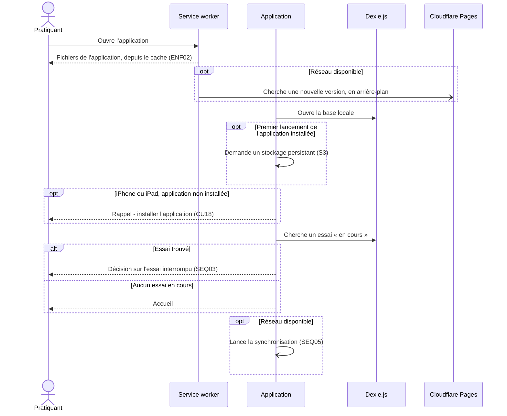
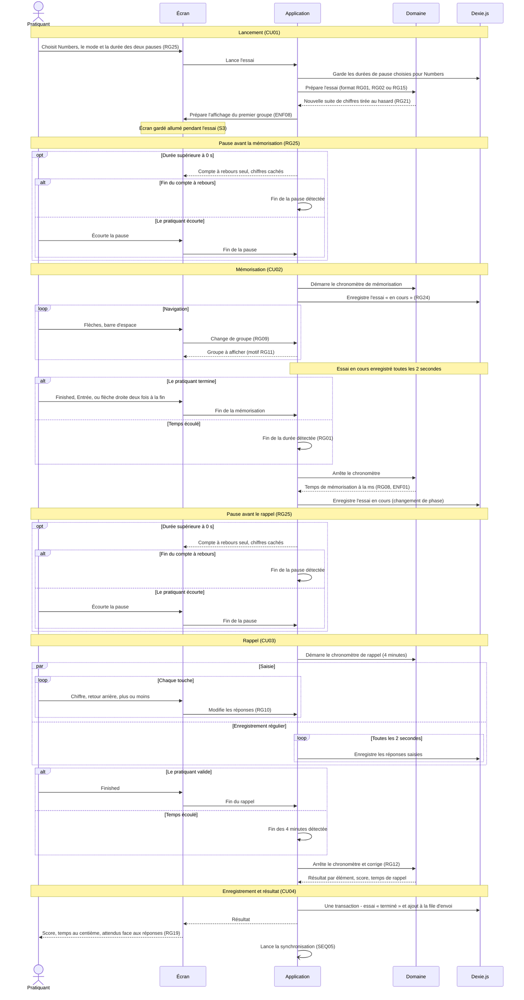
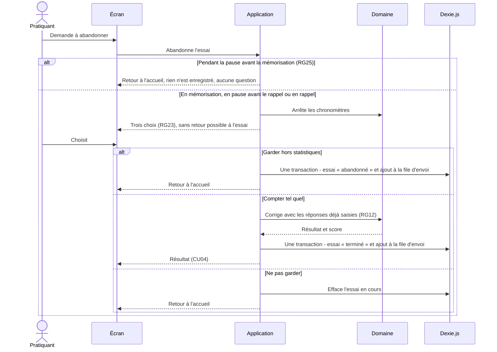
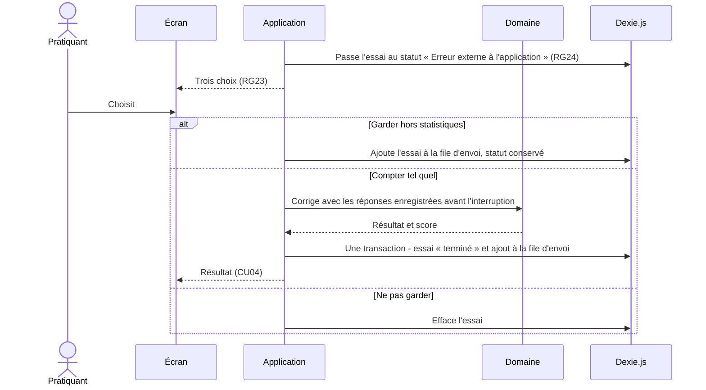
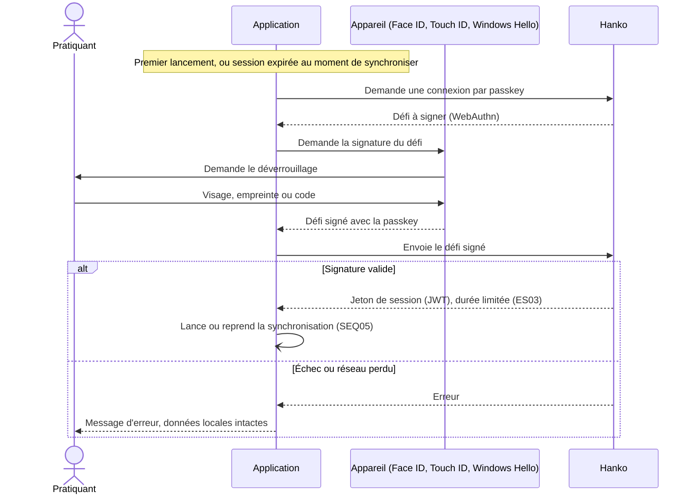
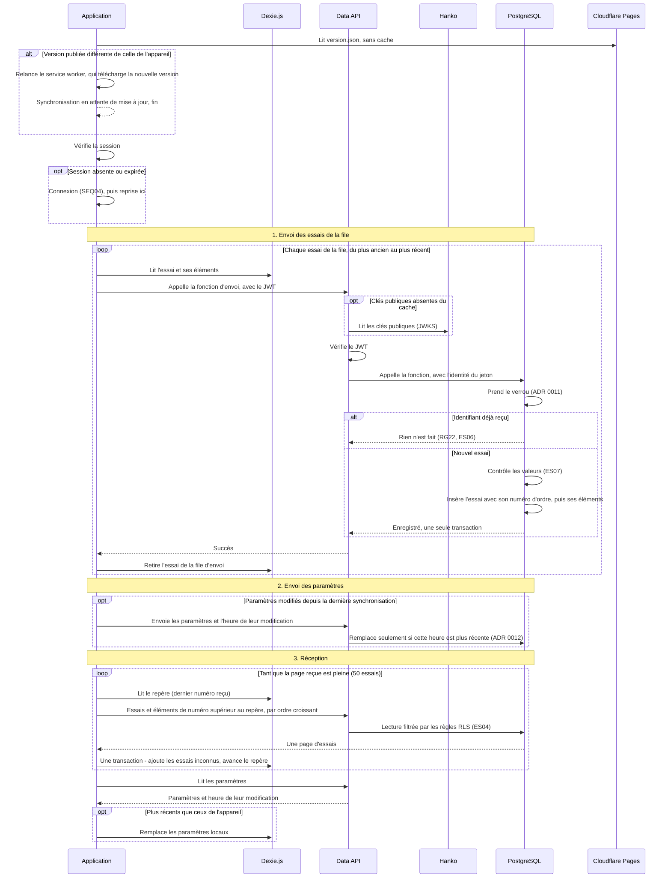
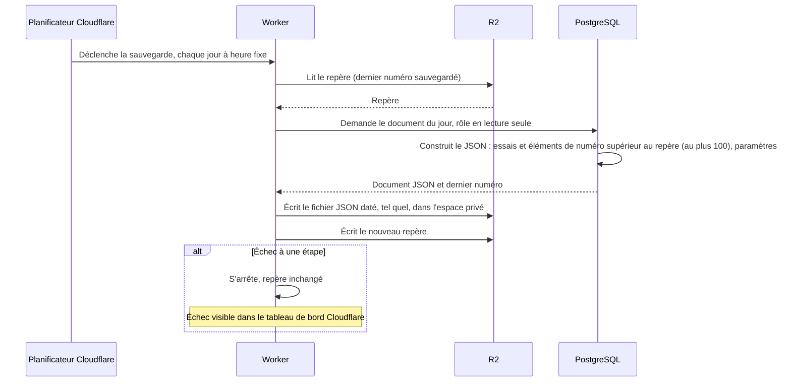
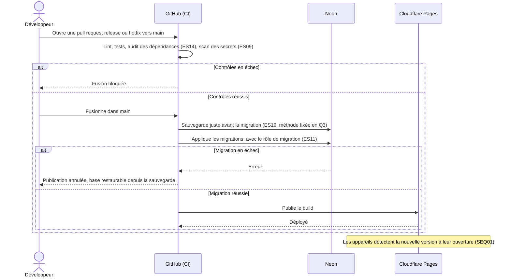

# S5 — Diagrammes de séquence

Amont : [cas d'utilisation](cas-utilisation.md), [architecture](../architecture.md), [contraintes techniques](../contraintes-techniques.md), [règles de gestion](../../01-besoin/regles-de-gestion.md), [exigences de sécurité](../../03-analyse-securite/exigences-securite.md).

## En bref

- **7 diagrammes**, un par flux clé du lot 1 : ouverture, essai, abandon et interruption, connexion, synchronisation, sauvegarde, déploiement.
- **Une pause précède la mémorisation et une autre précède le rappel** (0 à 20 s, écourtables). Elles restent hors chronomètre (RG25).
- **Un essai se déroule entièrement sur l'appareil**, sans réseau. Il n'est envoyé à Neon qu'une fois **terminé** ou une fois son sort décidé.
- **Un essai est envoyé par une seule fonction SQL**, en une transaction : l'essai et ses éléments arrivent ensemble, ou pas du tout ([ADR 0010](../adr/0010-envoi-essai-fonction-sql.md)).
- **Chaque essai reçu par la base prend un numéro d'ordre.** L'appareil et le Worker de sauvegarde demandent simplement « les numéros après le dernier vu ». Un verrou dans la fonction empêche tout essai sauté ([ADR 0011](../adr/0011-repere-numero-ordre-verrou.md)).
- **Pour les paramètres, la modification la plus récente gagne**, selon l'heure de l'appareil où elle a été faite ([ADR 0012](../adr/0012-conflits-parametres-heure-appareil.md)).

## Liste des diagrammes

| Diagramme | Flux | Cas d'utilisation | Exigences et règles |
|---|---|---|---|
| **SEQ01** : Ouverture de l'application | Démarrage hors ligne, essai interrompu, lancement de la synchronisation | CU06, CU17, CU18 | ENF02, RG24 |
| **SEQ02** : Essai Numbers | Lancer, pause, mémoriser, pause, restituer, corriger, enregistrer | CU01 à CU04 | EF08 à EF10, EF23, RG01, RG08 à RG12, RG21, RG25, ENF01, ENF08 |
| **SEQ03** : Abandon et interruption | Les trois choix, après un abandon ou une interruption | CU01, CU05, CU06 | EF11, RG23, RG24, RG25 |
| **SEQ04** : Connexion | Passkey, puis jeton de session | CU16 | ES01 à ES03 |
| **SEQ05** : Synchronisation | Envoi sans doublon, réception, paramètres | CU17 | EF21, RG22, ES04 à ES07 |
| **SEQ06** : Sauvegarde | Export quotidien et incrémental vers R2 | CU19 | ES17, ES18 |
| **SEQ07** : Déploiement | Pull request, tests, migrations, publication | — | ES09, ES11, ES14, ES19 |

## Décisions prises pour S5

| Décision | Choix du développeur | Où |
|---|---|---|
| **Envoi d'un essai** | Une fonction SQL en base enregistre l'essai et ses éléments en une transaction. | [ADR 0010](../adr/0010-envoi-essai-fonction-sql.md), SEQ05 |
| **Repère de réception** | Un numéro d'ordre donné par la base. Un verrou dans la fonction garantit que les numéros suivent l'ordre d'enregistrement. | [ADR 0011](../adr/0011-repere-numero-ordre-verrou.md), SEQ05, SEQ06 |
| **Conflit sur les paramètres** | L'heure de l'appareil où la modification a été faite. La plus récente gagne. | [ADR 0012](../adr/0012-conflits-parametres-heure-appareil.md), SEQ05 |
| **Enregistrement de l'essai en cours** | Toutes les N secondes, plus à chaque changement de phase. | SEQ02, SEQ03 |

## Valeurs retenues

> Décision : **N = 2 secondes** pour l'enregistrement de l'essai en cours. L'essai est aussi enregistré quand l'onglet passe en arrière-plan ou se ferme (événements `visibilitychange` et `pagehide`), ce qui réduit encore la perte en cas d'interruption.

> Décision : la synchronisation est relancée **toutes les 5 minutes** tant que l'application est ouverte. Avec une heure d'usage par jour, Neon reste éveillé environ 35 heures par mois, sous la limite de 100 heures ([S3](../contraintes-techniques.md)).

> Décision : la réception se fait par **pages de 50 essais**, et le Worker sauvegarde **au plus 500 essais** par exécution, pour rester sous les 10 ms de calcul. S'il en reste, la sauvegarde suivante continue.

> Décision : un essai **refusé par la base** (valeur hors bornes, ES07) est marqué « refusé » sur l'appareil, reste consultable, et est signalé au pratiquant. La file d'envoi continue avec les essais suivants, au lieu de rester bloquée. Ce cas révèle un défaut de l'application.

> Décision : les paramètres sont envoyés par la fonction SQL `save_settings`, qui ne remplace les valeurs que si la modification reçue est plus récente ([ADR 0018](../adr/0018-roles-et-regles-acces.md)).

> Décision : une nouvelle version de l'application **n'est jamais appliquée pendant un essai**. Comportement exact de la mise à jour fixé en Q3.

## Participants

| Participant | Ce que c'est |
|---|---|
| **Pratiquant** | Le seul utilisateur ([persona](../../01-besoin/persona.md)) |
| **Écran** | Couche Présentation : routes et composants Svelte |
| **Application** | Couche Application : cas d'usage (essai, abandon, synchronisation) |
| **Domaine** | Couche Domaine : formats, tirage, chronomètre, correction, score. Lit une horloge monotone (`performance.now()`) |
| **Dexie.js** | Base locale de l'appareil (IndexedDB), dont la file d'envoi |
| **Service worker** | Cache de l'application ([ADR 0008](../adr/0008-service-worker-vite-plugin-pwa.md)) |
| **Hanko** | Service de connexion par passkey ([ADR 0003](../adr/0003-connexion-hanko.md)) |
| **Data API** | Point d'entrée HTTP de Neon. Vérifie le jeton, puis transmet à PostgreSQL |
| **PostgreSQL** | Base de référence, avec ses règles d'accès RLS |
| **Worker** et **R2** | Sauvegarde planifiée et son stockage privé ([ADR 0009](../adr/0009-sauvegarde-cloudflare-worker-r2.md)) |

Les diagrammes montrent les échanges utiles à la compréhension. Les noms techniques exacts (tables, fonctions, colonnes) seront fixés au dictionnaire de données (S7) et au MPD (S10).

## 1. SEQ01 — Ouverture de l'application

| Point clé | Détail |
|---|---|
| **Aucun réseau nécessaire** | L'application, les données et l'historique viennent de l'appareil. La connexion n'est demandée qu'au moment de synchroniser. |
| **Déclencheurs suivants de la synchronisation** | Retour du réseau, fin d'un essai, et toutes les 5 minutes tant que l'application est ouverte (CU17). |
| **Mise à jour** | Une nouvelle version téléchargée n'est pas appliquée pendant un essai (valeur retenue ci-dessus) : un encart la propose hors essai ([déploiement](../../06-qualite-deploiement/deploiement.md), section 5). |
| **Rappel d'installation** | Sur iPhone et iPad sans installation, à chaque ouverture ; « Plus tard » le ferme jusqu'à la prochaine (CU18). |

## 2. SEQ02 — Essai Numbers

Scénario nominal de CU01 à CU04. L'abandon (CU05) est dans SEQ03.

| Point clé | Détail |
|---|---|
| **Tirage et affichage avant le chronomètre** | La suite est tirée et le premier groupe préparé **avant** la pause et le départ du chronomètre : le temps mesuré ne compte pas la préparation (ENF08). |
| **Pauses hors chronomètre** | Chaque chronomètre ne démarre qu'à la fin de la pause qui le précède. Les pauses ne comptent dans aucun temps et ne sont pas enregistrées avec l'essai (RG25). |
| **Chronomètre indépendant de l'affichage** | Le domaine lit l'horloge monotone. L'affichage du temps n'est qu'une lecture : un écran lent ne fausse pas la mesure (ENF01, R6). |
| **Essai en cours** | Enregistré au démarrage de la mémorisation (décision CU01), toutes les 2 secondes, à chaque changement de phase et quand l'onglet passe en arrière-plan. En cas d'interruption, on perd au plus 2 secondes de saisie. |
| **Fin de l'essai en une transaction** | Le passage à « terminé » et l'ajout à la file d'envoi sont écrits ensemble dans Dexie.js. Un essai terminé est donc toujours dans la file, jamais perdu (ENF07). |
| **Immuable dès la fin** | Après cette transaction, l'application ne propose plus aucune modification (RG18). |

## 3. SEQ03 — Abandon et interruption

### 3.1 Abandon volontaire (CU05)

### 3.2 Essai interrompu (CU06)

Appelé depuis SEQ01, quand un essai « en cours » est trouvé à l'ouverture.

| Point clé | Détail |
|---|---|
| **Jamais envoyé avant la décision** | Un essai en cours ou interrompu n'entre dans la file d'envoi qu'après le choix. « Ne pas garder » n'a donc jamais rien à supprimer côté serveur (ES05). |
| **Temps d'un essai interrompu** | Ceux du dernier enregistrement de l'essai en cours, soit au plus 2 secondes d'écart avec la réalité. |
| **Deux statuts distincts** | « Abandonné » pour un abandon volontaire, « Erreur externe à l'application » pour une interruption subie (décision CU06). |

## 4. SEQ04 — Connexion

| Point clé | Détail |
|---|---|
| **La clé privée ne quitte jamais l'appareil** | Hanko ne reçoit qu'un défi signé. Rien ne peut être hameçonné (ES02). |
| **Nouvel appareil sans passkey** | La passkey est partagée par le gestionnaire de mots de passe du système, ou utilisée depuis un autre appareil en scannant un QR code (CU16). |
| **Après une longue pause** | La première requête réveille le projet Hanko : la connexion est un peu plus lente ([S3](../contraintes-techniques.md)). |
| **Stockage du jeton** | Fixé en SE6 (sécurisation du back et de l'authentification). |

## 5. SEQ05 — Synchronisation

### Cas d'échec

| Cas | Ce qui se passe |
|---|---|
| **Version publiée illisible** | La synchronisation s'arrête avant tout envoi, et reprendra au prochain déclencheur : un essai n'est jamais envoyé sans savoir si l'appareil est à jour ([ADR 0023](../adr/0023-compatibilite-des-versions.md)). |
| **Appareil pas à jour** | Rien n'est envoyé ni reçu ; la pastille l'indique, l'encart propose la mise à jour ([déploiement](../../06-qualite-deploiement/deploiement.md), section 5). |
| **Réseau perdu en cours de route** | La synchronisation s'arrête. Les essais non confirmés restent dans la file : le prochain envoi les rejoue sans doublon. |
| **Jeton refusé** (session expirée entre-temps) | Connexion (SEQ04), puis reprise au début. |
| **Essai refusé par la base** (ES07) | L'essai est marqué « refusé » sur l'appareil, signalé, et la file continue (valeur retenue ci-dessus). |
| **Neon en veille** | La première requête le réveille : la synchronisation est un peu plus lente, sans action manuelle. |

### Points clés

| Point clé | Détail |
|---|---|
| **Tout ou rien** | La fonction enregistre l'essai et ses éléments dans une seule transaction : un autre appareil ne peut jamais recevoir un essai incomplet ([ADR 0010](../adr/0010-envoi-essai-fonction-sql.md)). |
| **Propriétaire imposé par la base** | La fonction s'exécute avec les droits de l'appelant, donc sous les règles RLS. Le propriétaire est l'identité du jeton, jamais une valeur envoyée par l'appareil. Seul l'identifiant du compte unique est accepté ([S3](../contraintes-techniques.md), ES01, ES04). |
| **Aucune modification possible** | La fonction ne fait qu'insérer. Un essai déjà reçu n'est jamais réécrit (RG18, ES05). |
| **Aucun essai sauté** | Grâce au verrou, les numéros d'ordre suivent l'ordre d'enregistrement. « Numéro supérieur au repère » ne peut donc rien oublier ([ADR 0011](../adr/0011-repere-numero-ordre-verrou.md)). |
| **Ses propres essais reviennent** | La réception renvoie aussi les essais envoyés par cet appareil. Ils sont reconnus par leur identifiant et ignorés. |
| **Dates d'origine conservées** | Les dates et les temps sont ceux de l'appareil, enregistrés tels quels. Le numéro d'ordre s'y ajoute, sans les remplacer (RG22). |
| **Une seule synchronisation à la fois** | Sur un appareil, une synchronisation déjà en cours n'est pas relancée par un autre déclencheur. |

## 6. SEQ06 — Sauvegarde

| Point clé | Détail |
|---|---|
| **Repère gardé dans R2** | Le Worker n'a qu'un accès en lecture à la base (ES11) : il garde donc son repère dans R2, à côté des sauvegardes. |
| **Fichier avant repère** | Le repère n'avance qu'après l'écriture du fichier. En cas d'échec, rien n'est perdu : la sauvegarde suivante reprend au dernier repère. |
| **Doublons possibles entre fichiers** | Si le fichier est écrit mais pas le repère, les mêmes essais seront dans deux fichiers. La restauration ignore les identifiants déjà vus (ES17). |
| **Instantané des paramètres** | Les paramètres sont recopiés chaque jour en entier. Les systèmes s'y ajouteront au lot 5. |
| **Document construit par la base** | Le Worker ne dispose que de 10 ms de calcul : il transmet le JSON sans le parcourir ([ADR 0032](../adr/0032-worker-de-sauvegarde.md)). |
| **Lignes brutes** | Chaque table telle quelle, numéro d'ordre compris : une restauration garde les numéros ([ADR 0011](../adr/0011-repere-numero-ordre-verrou.md)). |

## 7. SEQ07 — Déploiement

| Point clé | Détail |
|---|---|
| **Migrations avant publication** | La base est prête avant que la nouvelle version de l'application ne l'utilise. |
| **Migrations uniquement par la CI** | Aucune migration manuelle en production (ES19). Chaque tâche n'a que le secret dont elle a besoin (ES11). |
| **Anciennes versions encore en service** | Un appareil resté hors ligne garde l'ancienne version et enverra ses essais plus tard. La base doit donc rester compatible avec la version précédente (voir points ouverts). |

## Points ouverts

| Point | Pourquoi | Quand |
|---|---|---|
| **Compatibilité de la fonction d'envoi avec les anciennes versions** | Un appareil resté longtemps hors ligne envoie ses essais avec l'ancienne version. La fonction doit continuer à les accepter, ou être versionnée. | Q3 |
| **Méthode de sauvegarde avant migration** | Branche Neon, export JSON vers R2, ou autre (ES19). | Q3 |
| **Accès du Worker aux tables protégées par RLS** | Le rôle en lecture seule doit lire les essais sans être le propriétaire connecté. | S11, SE4 |
| **Stockage du jeton de session** | Cookie ou stockage local, durée de session (ES03). | SE6 |
| **Prise en charge par la Data API** des appels de fonction et des lectures d'essais avec leurs éléments | Les deux sont utilisés dans SEQ05. | Sprint 0 |
