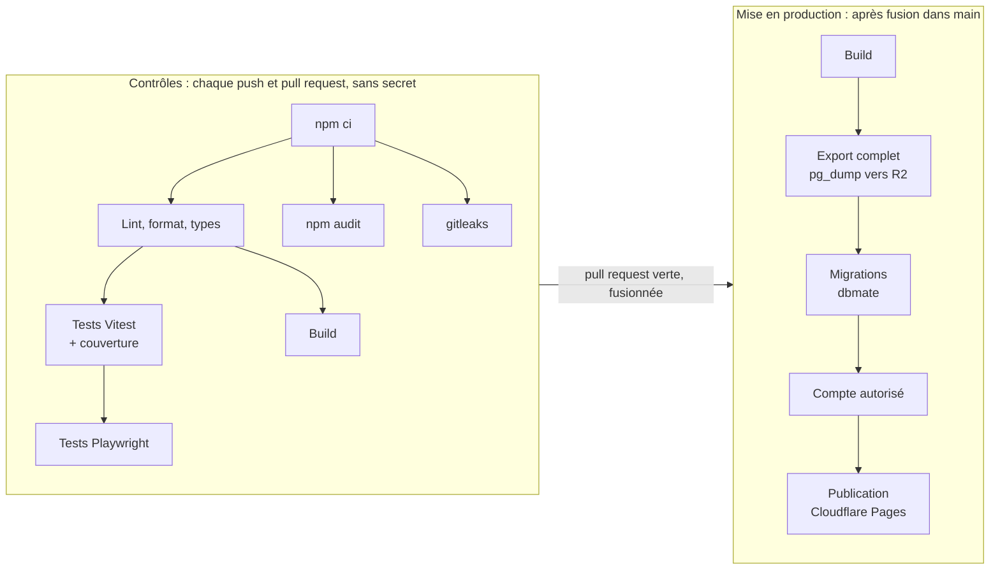

# Q3 — Déploiement et CI/CD

Amont : [conventions et workflow Git](../02-projet/conventions.md), [architecture](../04-specifications/architecture.md) (environnements, secrets), [séquence de déploiement](../04-specifications/uml/sequences.md), [sécurité de la base](../05-securite/bdd.md) (sauvegardes, migrations), [sécurité du back](../05-securite/back.md) (CI), [surface d'attaque](../05-securite/surface-attaque.md), [stratégie de tests](tests.md), [ADR 0022](../04-specifications/adr/0022-migrations-dbmate.md), [ADR 0023](../04-specifications/adr/0023-compatibilite-des-versions.md).

## En bref

- **Deux environnements** : le poste du développeur (branche Neon de dev) et la production. Aucune prévisualisation.
- **Deux chaînes automatiques dans GitHub Actions** :
  - les **contrôles**, à chaque push et sur chaque pull request, sans aucun secret ;
  - la **mise en production**, après la fusion dans `main` : export complet vers R2, migrations, publication. Elle s'arrête au premier échec.
- **Migrations avec dbmate** : des fichiers SQL versionnés, appliqués en production **uniquement par la CI** (ES19).
- **Mise à jour sur les appareils** : un bandeau « Nouvelle version » apparaît hors essai. Tant que la mise à jour n'est pas faite, la synchronisation attend ; la nouvelle version convertit la file d'envoi, puis l'envoie.
- **Outils** : ESLint, Prettier et svelte-check pour le lint ; gitleaks pour le scan des secrets, en local et dans la CI.

## Décisions prises

| Décision | Choix du développeur | Où |
|---|---|---|
| **Lint et formatage** | ESLint, Prettier, svelte-check | Section 4 |
| **Migrations** | dbmate | Section 3, [ADR 0022](../04-specifications/adr/0022-migrations-dbmate.md) |
| **Compatibilité avec les anciennes versions** | Mise à jour d'abord : la base n'accepte que le format courant, l'appareil se met à jour puis convertit sa file d'envoi | Section 5, [ADR 0023](../04-specifications/adr/0023-compatibilite-des-versions.md) |
| **Installation d'une nouvelle version** | Bandeau hors essai | Section 5, [ADR 0023](../04-specifications/adr/0023-compatibilite-des-versions.md) |
| **Scan des secrets** | gitleaks, avant chaque commit et dans la CI | Section 4 |

Déjà décidé en amont : sauvegarde complète par `pg_dump` vers R2 avant chaque migration ([sécurité de la base](../05-securite/bdd.md)), puis publication par la CI après les migrations ([séquence de déploiement](../04-specifications/uml/sequences.md)). Ces deux décisions ferment deux points ouverts des séquences : la méthode de sauvegarde avant migration, et la compatibilité de la fonction d'envoi.

## 1. Les chaînes de la CI

### Contrôles

Déclenchés par chaque push (`develop`, `release/*`, `hotfix/*`) et par chaque pull request vers `main`. La fusion vers `main` est bloquée tant qu'ils ne sont pas tous verts.

| Contrôle | Commande | Bloque si |
|---|---|---|
| **Installation** | `npm ci` (fichier de verrouillage, ES14) | Le fichier de verrouillage ne correspond pas |
| **Lint et format** | ESLint, `prettier --check` | Une règle est enfreinte ou un fichier mal formaté |
| **Types** | `svelte-check` | Une erreur de type |
| **Tests** | Vitest (unitaires, intégration, base sur PGlite), avec le seuil de couverture du domaine | Un test échoue ou la couverture passe sous le seuil ([stratégie de tests](tests.md)) |
| **Bout en bout** | Playwright : Chromium, Firefox, WebKit et appareils émulés | Un parcours échoue (la mesure de latence ne bloque pas) |
| **Audit** | `npm audit` | Une vulnérabilité élevée ou critique |
| **Secrets** | gitleaks sur les commits poussés | Un secret est trouvé |
| **Build** | `vite build` | Le build échoue |

> Décision : `npm audit` bloque à partir du niveau **élevé** (`--audit-level=high`). Une vulnérabilité faible ou moyenne est signalée, et traitée par la [maintenance](maintenance.md).

Le jeton de ces tâches est en **lecture seule**, et elles n'ont **aucun secret** : une pull request venant d'une copie du repo ne peut rien atteindre ([sécurité du back](../05-securite/back.md)).

### Mise en production

Déclenchée par la fusion d'une pull request `release/X.Y.Z` ou `hotfix/X.Y.Z` dans `main`. Elle tourne dans l'**environnement `production`** de GitHub, réservé à la branche `main`, qui seul détient les secrets de production (ES11). Une seule mise en production tourne à la fois.

| Étape | Ce qu'elle fait | Secret utilisé |
|---|---|---|
| **1. Build** | Construit l'application depuis le commit fusionné | Aucun |
| **2. Export complet** | `pg_dump` de toute la base, envoyé dans l'espace privé de R2 ; le nom du fichier porte la date et la version | Rôle de migration, écriture dans R2 |
| **3. Migrations** | `dbmate up` : applique les migrations pas encore appliquées, chacune dans une transaction, sous un verrou qui fait attendre une autre exécution | Rôle de migration |
| **4. Compte autorisé** | Enregistre le compte unique dans `accounts`, s'il n'y est pas déjà ([modèle physique](../04-specifications/bdd/mpd.md)) | Rôle de migration, identifiant du compte |
| **5. Publication** | Envoie le build à Cloudflare Pages | Jeton Cloudflare limité à Pages |

Les connexions à PostgreSQL sont chiffrées (TLS obligatoire). `pg_dump` doit avoir la même version majeure que le serveur Neon.

### Que se passe-t-il en cas d'échec ?

| Échec à l'étape | Effet | Que faire |
|---|---|---|
| **Build ou export** | Rien n'a changé : ni la base, ni le site | Corriger, puis relancer la tâche |
| **Migration** | La migration en échec est annulée par sa transaction ; les migrations précédentes du même lot restent appliquées ; **le site n'est pas publié** | Lire l'erreur, corriger par un hotfix ; restaurer depuis l'export de l'étape 2 seulement si une migration réussie a abîmé des données ([maintenance](maintenance.md)) |
| **Publication** | La base est migrée, l'ancienne version du site reste en ligne | Relancer la tâche : les étapes 2 à 4 n'ont plus rien à faire ou sont sans effet |

Chaque échec envoie un e-mail de GitHub ([sécurité du back](../05-securite/back.md)).

## 2. Secrets de la CI

| Secret | Nom dans GitHub | Rangé dans | Utilisé par | Droits |
|---|---|---|---|---|
| **Adresse de la base avec le rôle de migration** (connexion directe, sans pooler) | `MIGRATION_DATABASE_URL` | Environnement `production` | Export, migrations, compte autorisé, reprise | Propriétaire des tables ; ne peut pas modifier un essai terminé ([accès aux données](../04-specifications/acces.md)) |
| **Clé R2**, avec l'adresse et le nom de l'espace | `R2_ACCESS_KEY_ID`, `R2_SECRET_ACCESS_KEY`, `R2_ENDPOINT`, `R2_BUCKET` | Environnement `production` | Export, reprise | Lecture et écriture sur l'espace de sauvegarde seulement |
| **Identifiant du compte autorisé** | `AUTHORIZED_ACCOUNT_ID` | Environnement `production` | Compte autorisé | — |
| **Jeton Cloudflare**, avec l'identifiant du compte | `CLOUDFLARE_API_TOKEN`, `CLOUDFLARE_ACCOUNT_ID` | Environnement `production` | Publication | Modification de Cloudflare Pages seulement |

Les **adresses publiques** du front ne sont pas des secrets (ES08) : elles sont rangées en **variables** de l'environnement `production`, et lues au build ([`src/env.ts`](../../src/env.ts)). Un build sans elles échoue.

| Variable | Nom dans GitHub | Utilisée par |
|---|---|---|
| **Adresse de l'API Hanko** | `PUBLIC_HANKO_API_URL` | Build : écran de connexion ([ADR 0030](../04-specifications/adr/0030-connexion-hanko-elements.md)) |
| **Adresse de la Data API** de la branche de production, terminée par `/rest/v1` | `PUBLIC_DATA_API_URL` | Build : synchronisation ([ADR 0031](../04-specifications/adr/0031-client-data-api-postgrest.md)) |

Dans les contrôles et les tests de bout en bout, des adresses factices (`https://hanko.test`, `https://data-api.test/…`) remplacent les adresses réelles : Hanko et la Data API y sont simulés ([stratégie de tests](tests.md)).

Aucun de ces secrets n'est sur le poste du développeur ([surface d'attaque](../05-securite/surface-attaque.md)). La procédure en cas de fuite est dans la [sécurité de la base](../05-securite/bdd.md), section 3.

## 3. Migrations (dbmate)

| Règle | Détail |
|---|---|
| **Fichiers** | `db/migrations/AAAAMMJJHHMMSS_nom.sql`, en SQL pur, avec une partie `-- migrate:up` et une partie `-- migrate:down`. Commités avec le code. |
| **Première migration** | Le script testé du [modèle physique](../04-specifications/bdd/mpd.md) et de l'[accès aux données](../04-specifications/acces.md) : tables, fonctions, déclencheurs, rôles, règles RLS. |
| **Suivi** | dbmate note chaque migration appliquée dans sa table `dbmate.schema_migrations`, rangée **hors du schéma `public`** exposé par la Data API. |
| **Testées avant la fusion** | Les tests de la base reconstruisent la base depuis les migrations (PGlite, dans la CI), puis `dbmate up` est lancé sur la branche Neon de dev, depuis le poste. |
| **En production** | Uniquement par la CI, après l'export complet (ES19). Aucune migration à la main. |
| **Retour en arrière** | La partie `down` sert sur le poste et sur la branche de dev. En production, on ne revient pas en arrière par `down` : on corrige par une nouvelle migration, ou on restaure l'export. |
| **Nouvelle table** | Elle arrive avec ses droits, ses règles RLS et sa règle de lecture pour la sauvegarde ; le test « aucune table sans RLS » le vérifie ([ADR 0018](../04-specifications/adr/0018-roles-et-regles-acces.md)). |

dbmate est un exécutable unique, installé dans la CI à une **version fixée et vérifiée par son empreinte** (ES14).

## 4. Outils de qualité du code

| Outil | Rôle | Où il tourne |
|---|---|---|
| **ESLint** (avec les règles pour Svelte et TypeScript) | Erreurs et mauvaises pratiques dans le code | Éditeur, CI |
| **Prettier** (avec le module Svelte) | Formatage identique partout | Éditeur à l'enregistrement, CI |
| **svelte-check** | Erreurs de type dans les composants et le TypeScript | Éditeur, CI |
| **gitleaks** | Scan des secrets | **Avant chaque commit** (hook git versionné dans le repo), CI |

Configuration de départ : celle proposée par SvelteKit à la création du projet, ajustée au sprint 0.

**Scan des secrets (ES09)**, en trois barrages :
1. **Avant chaque commit** : gitleaks, lancé par un hook git rangé dans le repo (`.githooks/pre-commit`) et activé par `git config core.hooksPath .githooks`.
2. **Dans la CI** : gitleaks sur les commits poussés.
3. **Chez GitHub** : blocage des push qui contiennent un secret, et alerte de détection.

Contrôle du sprint 0 : un faux secret est bloqué par chacun des trois barrages.

## 5. Mise à jour de l'application sur les appareils

| Situation | Comportement |
|---|---|
| **Nouvelle version publiée** | À l'ouverture, ou au retour du réseau, le service worker télécharge la nouvelle version, sans l'appliquer. |
| **Hors essai** (accueil, historique, résultat, paramètres) | Un bandeau « Nouvelle version disponible » s'affiche, avec un bouton pour l'installer. |
| **Pendant un essai** (lancement, pauses, mémorisation, rappel, abandon) | Aucun bandeau ; la version en cours n'est jamais remplacée. |
| **Bandeau ignoré** | L'application continue de fonctionner, hors ligne compris. Les essais terminés s'ajoutent à la file d'envoi, mais **la synchronisation attend** la mise à jour, et le bandeau l'indique. |
| **Après la mise à jour** | La base locale (Dexie.js) passe au nouveau format et **convertit la file d'envoi**, puis la synchronisation reprend. |

> Décision : pour savoir qu'elle est périmée, l'application lit, avant chaque synchronisation, un petit fichier `version.json` publié avec le site et jamais mis en cache. Si sa version diffère de celle de l'appareil, la synchronisation attend. Ainsi, un ancien format n'atteint jamais la base, et un essai valide n'est jamais marqué « refusé » à cause de sa version.

**Ce que cela impose à chaque lot** :
- toute modification du format d'un essai arrive avec sa **conversion Dexie.js** et son test d'intégration ([stratégie de tests](tests.md)) ;
- la migration de la base et la nouvelle version du site partent dans **la même mise en production** ;
- TR14 vérifie la mise à jour à la [recette](recette.md), à partir de la version 0.2.

## 6. Procédure de mise en production

**Release d'un lot** (version `X.Y.0`) :
1. `git flow release start X.Y.0` depuis `develop`.
2. Mettre à jour la version dans `package.json`, et ajouter la section `X.Y.0` au `CHANGELOG.md` ([livrables par lot](../04-specifications/livrables.md)).
3. Pousser la branche `release/X.Y.0`, puis ouvrir la pull request vers `main`.
4. Attendre que les contrôles soient verts, puis relire le diff : aucune donnée réelle, aucun secret (ES10).
5. Fusionner la pull request. La mise en production démarre ; suivre son déroulé dans l'onglet Actions.
6. En local : récupérer `main`, poser le tag signé `vX.Y.0`, le pousser, puis reporter `main` dans `develop` et pousser `develop` ([conventions](../02-projet/conventions.md)).
7. Créer la release GitHub du tag, avec la section du `CHANGELOG.md`.
8. Passer la [recette](recette.md) en production.

**Hotfix** (version `X.Y.Z`) : même circuit, avec `git flow hotfix start X.Y.Z` depuis `main`.

**Reprise de la base** en cas de perte ou de corruption : tâche lancée à la main dans la CI, décrite dans la [maintenance](maintenance.md).

## 7. Limites des offres gratuites

| Service | Limite | Usage |
|---|---|---|
| **GitHub Actions** | Gratuit et sans limite de minutes pour un repo public | Une exécution des contrôles par push, une mise en production par release |
| **Cloudflare Pages** | 500 publications par mois | Quelques-unes par mois |

Détail dans les [contraintes techniques](../04-specifications/contraintes-techniques.md).

## Points ouverts

| Point | Pourquoi | Quand |
|---|---|---|
| **Droits du jeton Cloudflare** | Vérifier qu'un jeton limité à Cloudflare Pages suffit pour publier. | Sprint 0 |
| **Version de `pg_dump`** | Elle doit suivre la version majeure de PostgreSQL chez Neon. | Sprint 0 |
| **Mise en cache des navigateurs de Playwright** dans la CI | Raccourcir les contrôles. | Sprint 0 |
